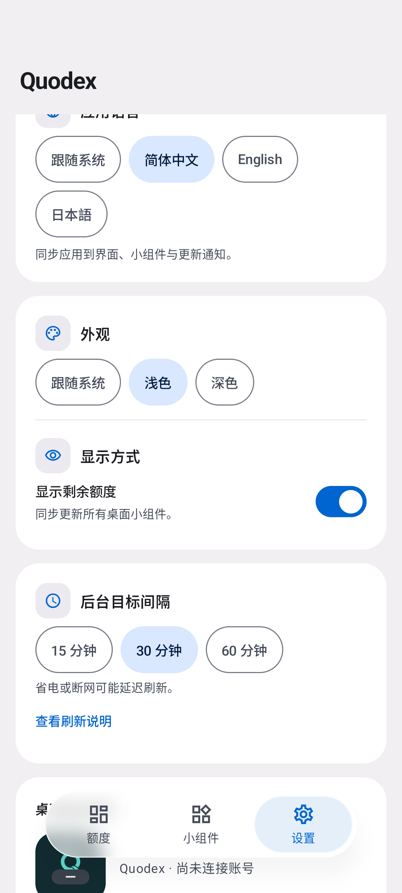
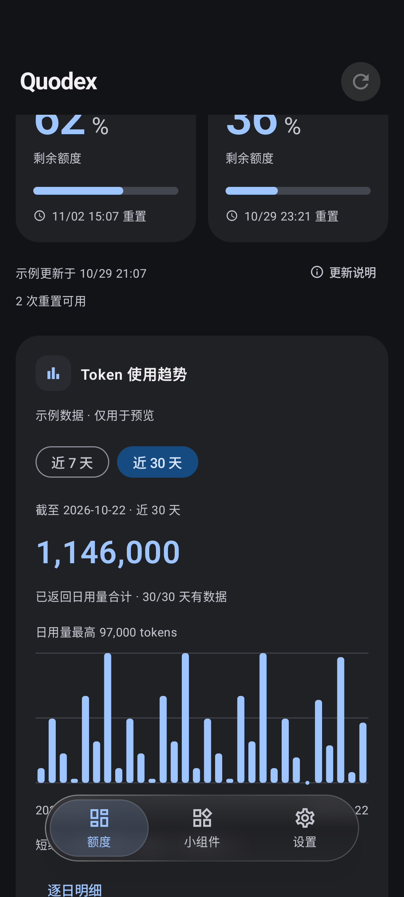
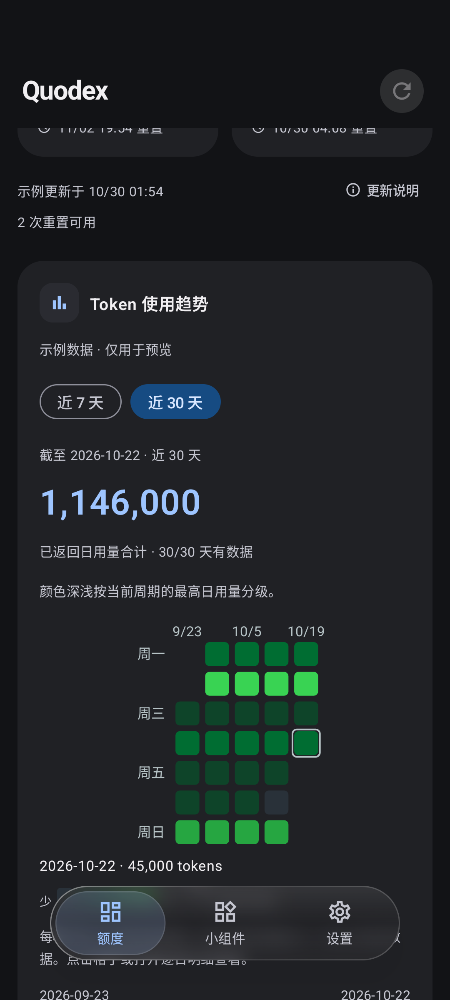
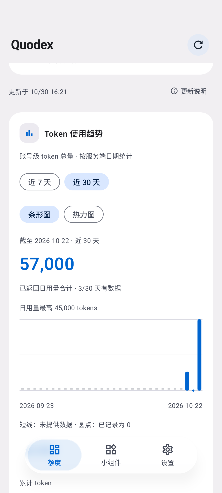
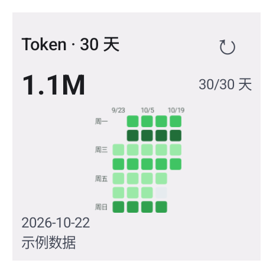

# Quodex

<picture>
  <source media="(prefers-color-scheme: dark)" srcset="docs/assets/brand/quodex-horizontal-on-dark.svg" />
  
</picture>

面向 Android 的 Codex 额度监控 App，支持桌面小组件、重置时间和 Token 使用趋势。Quodex 是独立第三方工具，与 OpenAI 无隶属关系。

> **当前公开预发布：0.1.0-alpha30**。近 7／30 天均可切换条形图与热力图，并记住选择；30 天热力图桌面组件默认 **2×2**。已包含中英日三语、液态玻璃风格悬浮导航、小米桌面权限提醒、App 内下载安装更新及网络自动重试。

[官网](https://tsonglew.github.io/quodex/) · [观看动效](https://tsonglew.github.io/quodex/#motion) · [公开 APK 与预发布](https://github.com/tsonglew/Quodex/releases) · [支持范围](docs/SUPPORT.md)

| 浅色 | 深色 |
| --- | --- |
|  |  |

以上为 alpha26 引入的[玻璃导航界面](docs/GLASS_NAVIGATION.md)，来自 API 37 模拟器，使用示例数据。alpha30 的图表切换与 2×2 组件截图见下方。[品牌与素材规范](docs/BRANDING.md)。

已验证的 alpha30 安装包见 [build-41033042814-1](https://github.com/tsonglew/Quodex/releases/tag/build-41033042814-1)。[对应 CI](https://github.com/tsonglew/Quodex/actions/runs/41033042814) 的六组 Android 设备测试、发布构建与固定签名流程全部通过；公开 APK 的版本、签名、SHA-256 和来源提交已核对。当前功能见下方，历史发布仍保留在 [Releases](https://github.com/tsonglew/Quodex/releases)。

| 30 日热力图 | 30 日条形图 | 2×2 桌面热力图 |
| --- | --- | --- |
|  |  |  |

以上为 alpha30 模拟器截图，数据为演示或测试数据。[热力图与切换说明](docs/TOKEN_HEATMAP.md)。已有桌面实例可能保留旧尺寸，缩小或重新添加即可使用 2×2 布局。

安装包、校验和与来源提交见 [GitHub Releases](https://github.com/tsonglew/Quodex/releases)。每次主分支发布须通过完整 CI 和固定签名验证，实际可安装版本以对应发布记录和 APK 附件为准。

- **额度与重置时间**：按服务端实际返回的周期展示，支持剩余／已用切换；没有返回用量时明确说明，不补成零或无限额度。
- **Token 趋势**：近 7／30 天均可切换条形图与 [GitHub 风格热力图](docs/TOKEN_HEATMAP.md)，记住图表选择，提供累计用量和逐日明细；缺失日期与实际零值分别标记，统计失败保留上次数据。兼容接口仍待真实账号验收，不提供输入／输出／缓存细分或费用估算。
- **桌面小组件**：标准额度、独立 2×1 额度与 2×2 的 30 天 Token 热力图，支持缩放、原地手动刷新和独立外观配置；点击热力图打开 App 的 30 日视图。后台刷新受 Android 网络、省电与厂商限制。
- **多语言**：设置 → 应用语言，支持跟随系统、简体中文、English、日本語；页面、小组件、桌面额度图标和更新提示同步切换。
- **桌面权限提醒**：小米／Redmi／POCO 添加桌面额度图标或小组件时，按系统状态提示开启桌面快捷方式权限，提供应用权限入口和手动添加指引。见[添加权限说明](docs/HOME_SCREEN_PERMISSION.md)。
- **显示与操作**：浅色／深色／跟随系统，固定刷新入口，各页独立浏览位置，整行可点的设置开关，大字体换行和宽屏侧边导航。设计依据与验收范围见 [UI/UX](docs/UI_UX.md)。

应用更新后台目标间隔为 12 小时，发现同签名、更高版本时通知一次。alpha24 起可在 App 内下载 APK、校验并调起系统安装确认，无需跳转 GitHub 手动下载。设置内可关闭自动检查、手动检查及开启系统通知。旧版需先安装支持该功能的签名版本。

alpha29 为额度、Token 统计、更新检查和 APK 下载加入[有限次数的自动重试](docs/NETWORK_RETRIES.md)，遵守服务端限流并支持随时取消。下载中断后从头重试并重新校验，下载界面显示尝试次数。

历史版本验收与发布流程

alpha22 的[原生动效录屏](https://tsonglew.github.io/quodex/#motion)保留为历史资料，展示页面淡入、额度条填充和 Token 柱条展开，采用示例数据；其深海青外观不代表当前界面。[动效说明与录屏来源](docs/MOTION.md)。alpha24 的[蓝色卡片界面与应用内更新](docs/ANDROID_DASHBOARD_UPDATE.md)、alpha25 的[多语言](docs/LOCALIZATION.md)、alpha26 的[玻璃导航](docs/GLASS_NAVIGATION.md)、alpha27 的[桌面权限提醒](docs/HOME_SCREEN_PERMISSION.md)、alpha29 的[网络重试](docs/NETWORK_RETRIES.md)均已包含在 alpha30 中。

alpha19 的小组件在 Android 12 及以上改用直接接收点击的透明 TextView，分开处理打开与刷新；固定 Glance 1.1.1 的布局覆盖由构建检查保护。当时的最终候选通过 API29／37 各 16 项模拟器回归，以及 API37 两项真实 TalkBack 探索／双击专项。小米完整 preview 的标题、时间、刷新手指点击与外观已验收；示例模式刷新跳过联网且不更新时间，正式签名覆盖升级与真实账号刷新仍待验收，见 [验证记录](docs/VALIDATION_XIAOMI_WIDGET_TOUCH.md)。这些历史结果不等同于本次深海青构建的完整回归。

alpha17 新增诊断报告的系统后台受限标记，帮助排查后台刷新延迟。alpha16 的 [PR #16 六组 CI](https://github.com/tsonglew/Quodex/actions/runs/38037325156) 已通过，覆盖 API 29／31／35／36／37.0／37.2。已提供本机诊断报告、最近 7 天的请求与刷新统计、后台任务状态，以及分品牌后台引导和小组件即时手动刷新。alpha16 修正诊断弹窗的主线程约束，固定签名覆盖升级已通过，记录见 [alpha16](docs/VALIDATION_ALPHA16.md)。真实账号续期、OEM 后台恢复和长期自用仍待验收。

历史 alpha17 预发布仍可在 [版本记录](https://github.com/tsonglew/Quodex/releases/tag/v0.1.0-alpha17)查阅；当前公开预发布见上方链接。

仓库配置在合并到 master 后运行完整 CI，生成固定签名 APK 并上传 GitHub Releases。每次构建以 `build-<runId>-<attempt>` 创建独立预发布，附 APK、SHA256SUMS 和来源信息，保留历史包；Actions 中的 `android-signed-apk` 同时保留 14 天。正式版本仍可按版本 tag 发布。是否已发布须核对实际 CI 和 Release 附件，本地 debug 构建不进入这一发布状态。

- [开发计划](docs/DEVELOPMENT_PLAN.md)
- [开发与验收 checklist](docs/DEVELOPMENT_CHECKLIST.md)
- [每次交付的 README 与官网同步约定](AGENTS.md)
- [GitHub milestones](https://github.com/tsonglew/Quodex/milestones)
- [实时开发进度](docs/PROGRESS.md)
- [CI/CD、预览 Deployments 与签名发布](docs/CI_CD.md)
- [隐私说明与数据流](docs/PRIVACY.md)
- [后台更新引导](docs/BACKGROUND_GUIDE.md)
- [小组件刷新修复验证](docs/VALIDATION_ALPHA06.md)
- [Codex 接入证据与边界](docs/CODEX_INTEGRATION.md)
- [接口兼容与故障维护策略](docs/COMPATIBILITY_POLICY.md)
- [品牌、Logo 与配色](docs/BRANDING.md)
- [界面规格](docs/UI_SPEC.md)
- [动效说明与录屏](docs/MOTION.md)
- [测试与自用验收](docs/TESTING.md)
- [历史修复 PR](https://github.com/tsonglew/Quodex/pull/8)
- [alpha03 验证记录与 2×1 安装包](docs/VALIDATION_ALPHA03.md)
- [alpha02 验证记录](docs/VALIDATION_ALPHA02.md)
- [首版验证与 APK 校验和](docs/VALIDATION.md)
- [原生页面和组件截图](docs/SCREENSHOTS.md)
- [产品简介、发布素材与使用帮助](docs/RELEASE_MATERIALS.md)

Android 10+，Kotlin 2.1.21、Compose、Glance、Room、DataStore 和 WorkManager。固定构建链为 AGP 8.10.1、Gradle 8.11.1、JDK 17，compileSdk／targetSdk 36。

已有 Android SDK 与 JDK 17 时执行 `./gradlew testDebugUnitTest lintDebug assembleDebug`。APK 位于 `app/build/outputs/apk/debug/app-debug.apk`。有设备或模拟器时执行 `./gradlew connectedDebugAndroidTest`。GitHub Actions 会保存 APK、测试报告及原生截图。

设备登录由用户在 OpenAI 页面完成，Quodex 不收集密码。示例模式须主动选择并明确标注，不执行额度请求。凭据通过 Android Keystore 加密保存在本机；退出清理本机连接，远程授权不会因此自动撤销。

当前账号覆盖、刷新限制和未完成验收见 [支持范围与已知限制](docs/SUPPORT.md)。

普通版与横条版桌面小组件都支持手动刷新：点击 `↻` 原地刷新额度，刷新期间显示 `…`，结果同步到其他已添加的小组件。点击小组件的标题、额度或其他主体区域会打开 Quodex；未连接账号时，刷新入口也会打开应用以完成连接。示例模式不请求真实额度。

设置中的“显示剩余额度”会同步到所有桌面小组件，开启显示剩余、关闭显示已用，并保留各组件主题。单个组件仍可独立配置；之后切换 App 中的全局开关会再次统一显示方式。

桌面额度图标：设置 → 桌面额度图标 → 添加到桌面，可将剩余百分比显示在 Quodex logo 上。支持短周期／每周选择、关闭百分比，以及示例、旧数据、受限和未连接标记；点击图标打开 App，随额度刷新更新。需在 Launcher 提示中确认添加；小米系手机会提供权限提醒，普通应用入口仍保留。[查看图标规格](docs/UI_SPEC.md#桌面额度图标)。
