<p align="center">
  <picture>
    <source media="(prefers-color-scheme: dark)" srcset="docs/assets/brand/quodex-horizontal-on-dark.svg" />
    
  </picture>
</p>

<h3 align="center">额度，心中有数。</h3>
<p align="center">在 Android 上集中查看 AI 服务额度与订阅，把 Codex 用量放到桌面。</p>

<p align="center">
  <a href="https://github.com/tsonglew/Quodex/actions/workflows/android.yml"></a>
  <a href="https://github.com/tsonglew/Quodex/releases"></a>
  <a href="LICENSE"></a>
  
  <a href="docs/LOCALIZATION.md"></a>
</p>

<p align="center">
  <a href="https://tsonglew.github.io/quodex/">官网</a> ·
  <a href="https://github.com/tsonglew/Quodex/releases">下载 APK</a> ·
  <a href="docs/README.md">使用文档</a> ·
  <a href="https://github.com/tsonglew/Quodex/issues/new/choose">反馈问题</a> ·
  <a href="CONTRIBUTING.md">参与贡献</a>
</p>

> [!NOTE]
> Quodex 目前处于 **Alpha 预发布**阶段，是独立第三方工具，与 OpenAI、DeepSeek、OpenCode、Kimi、WorkBuddy、Cursor 或 xAI 无隶属关系。兼容接口、账号覆盖和后台行为的边界见[支持范围](docs/SUPPORT.md)。

## 导航与玻璃界面（alpha36 源码）

沿用主分支新的三个入口 **总览 / 账号 / 设置**：总览展示已连接服务的关键额度或余额，点服务标题进入明细；账号集中管理 Codex、DeepSeek、OpenCode、Kimi、WorkBuddy、Cursor 和 Grok 的连接；设置改为紧凑分组列表。小组件和桌面额度图标统一放在 **设置 → 桌面展示**，Codex 退出迁至 **账号 → Codex**。

冷启动时先读取本机连接，再决定是否显示添加服务提示；已有 Codex 摘要可先显示，其他服务的读取不会阻塞它。

| 多服务总览 | 统一账号管理 | 紧凑设置 |
| :---: | :---: | :---: |
| 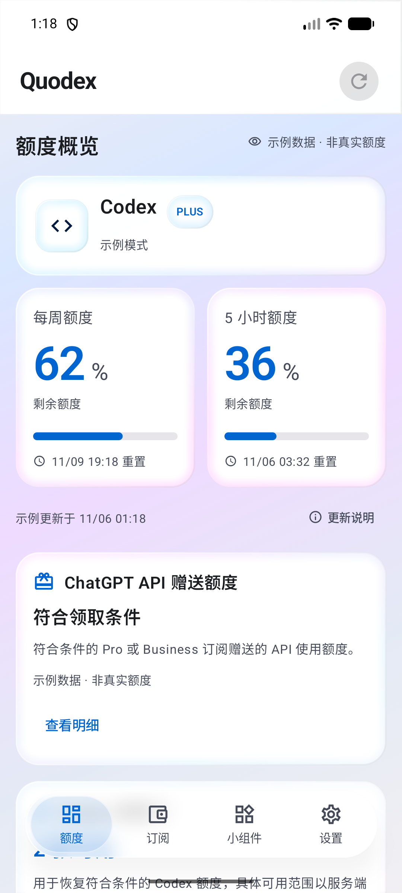 | 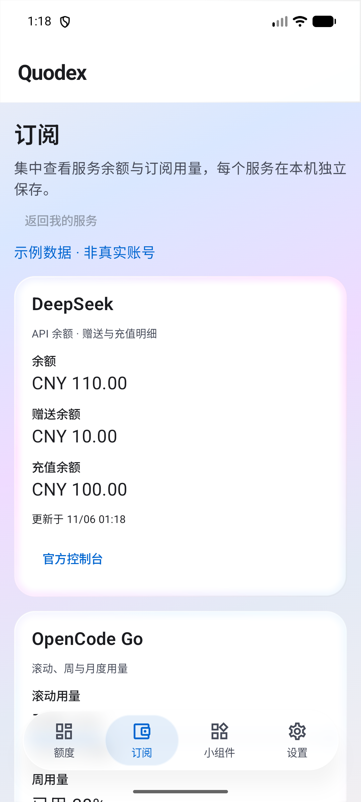 | 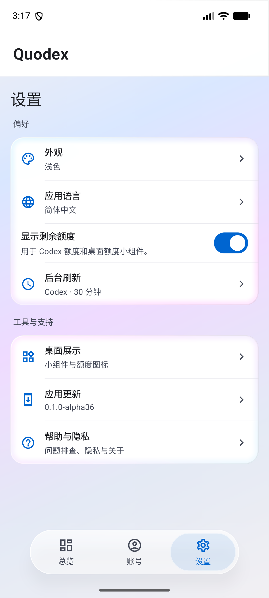 |

上方为融合导航改版的 alpha36 历史截图；alpha37 新服务见下方原生截图，未裁切或重绘；开发界面不等同于已发布 APK。[页面职责、路径与验证](docs/NAVIGATION.md)。历史发布 [alpha35](https://github.com/tsonglew/Quodex/releases/tag/build-42045239967-1) 保留四页导航；当前可安装版本请查看 [Releases 的实际产物](https://github.com/tsonglew/Quodex/releases)。

## 界面一览

| 订阅与余额 | Codex 用量趋势 | 桌面小组件 |
| :---: | :---: | :---: |
| 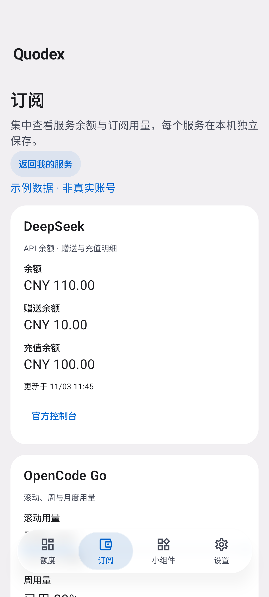 | 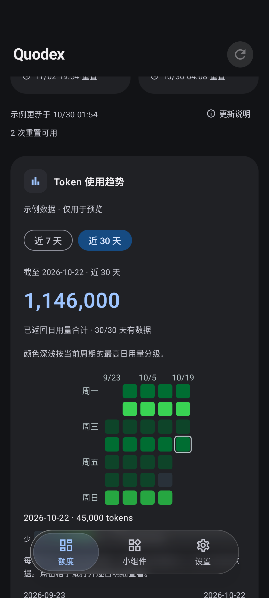 | 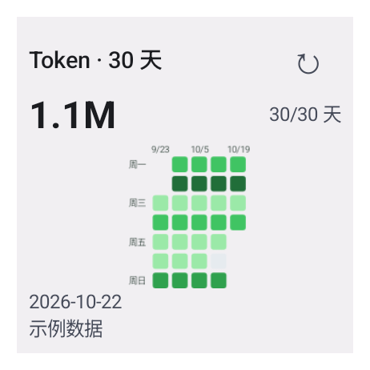 |

以上保留的历史截图来自 Android 模拟器中的 debug 构建，均为示例数据；订阅页为 alpha32，图表与组件为 alpha31。新版圆角 Q 品牌资源已纳入源码，已发布 APK 与历史截图可能仍显示旧标志。[alpha33 更新等待提示（合成状态）](docs/screenshots/updates-alpha33/update-cooldown.png) · [更多原生截图](docs/SCREENSHOTS.md) · [深色图表](docs/screenshots/token-heatmap-widget-dark.png) · [品牌素材](docs/BRANDING.md)

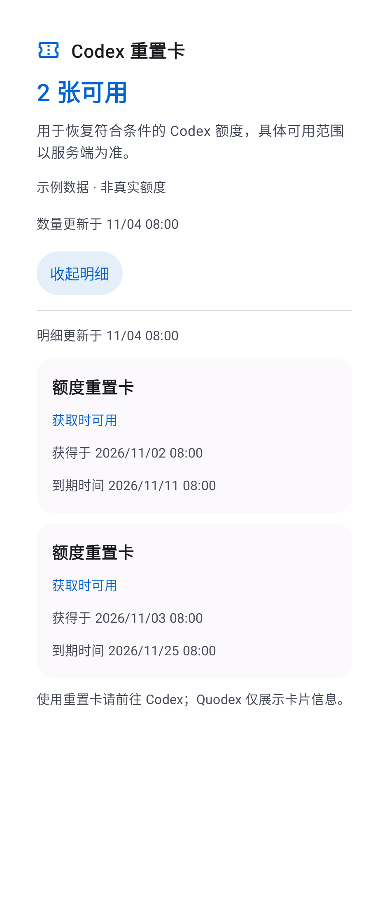

重置卡界面来自 alpha34 开发版的原生组件截图，使用合成示例数据，不代表真实账号权益。[截图来源与验收范围](docs/screenshots/reset-credits-alpha34/README.md)。功能是否已发布请以 Releases 中的实际 APK 为准。

| alpha35 玻璃材质 · 浅色 | alpha35 玻璃材质 · 深色 |
| :---: | :---: |
| 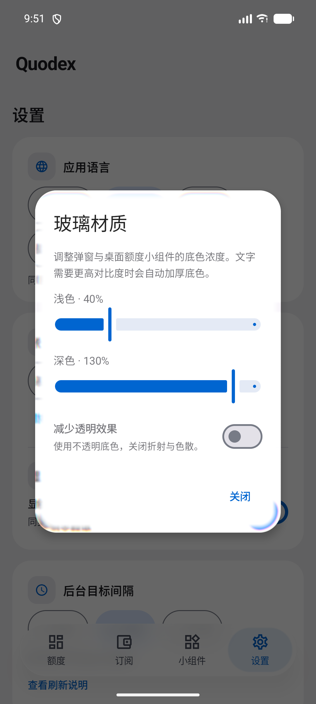 | 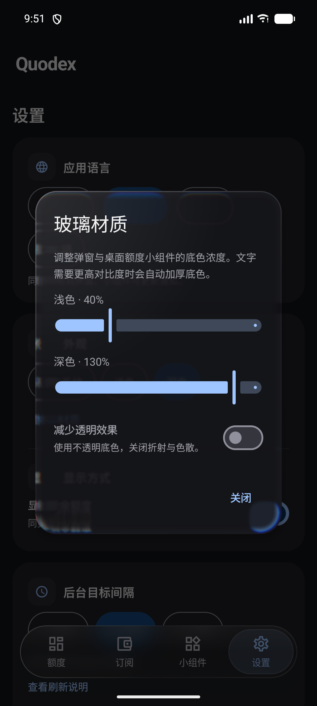 |

以上历史材质截图来自 alpha35 debug / API 37 模拟器，在本机示例模式中直接捕获，未裁切或重绘；不代表已发布 APK。[材质与验证范围](docs/LIQUID_GLASS.md)。

| alpha36 全界面玻璃 · 浅色 | alpha36 全界面玻璃 · 深色 |
| --- | --- |
|  | 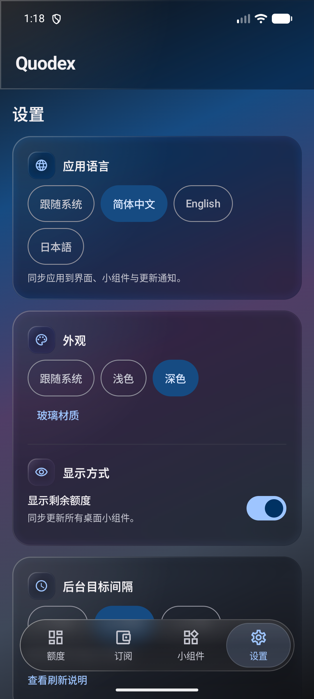 |

以上为历史 alpha36 debug / API 37 模拟器原生截图，未裁切或重绘；赠送额度均为合成示例，不代表真实账号。[截图来源与范围](docs/screenshots/all-glass-alpha36/README.md)。

| alpha39 Kimi 自动更新 | alpha39 WorkBuddy 自动更新 | alpha39 Grok／Cursor 自动更新 |
| --- | --- | --- |
| 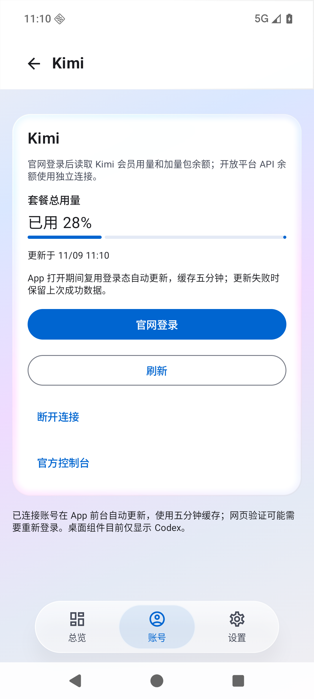 | 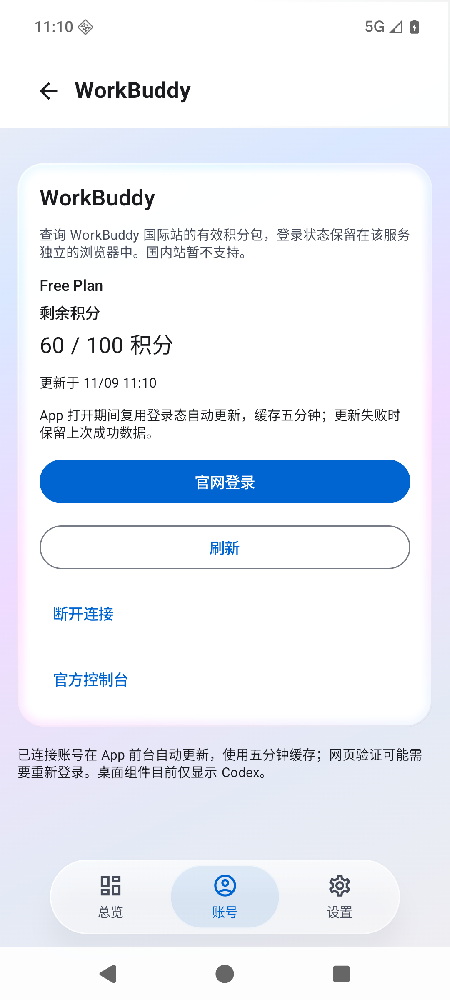 | 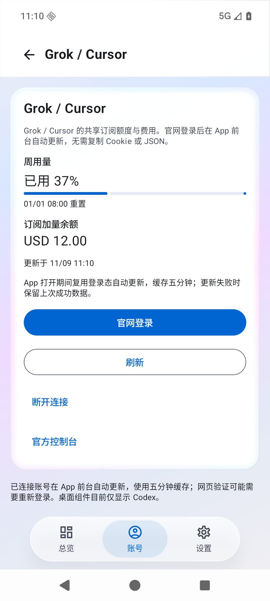 |

2026-11-09，alpha39 debug / API 36 原生截图，使用合成测试数据，未裁切或重绘；不代表真实 Android 账号完整登录已验收。截图对应本轮源码，安装包发布状态以 [Releases](https://github.com/tsonglew/Quodex/releases) 为准。[来源与验证](docs/screenshots/auto-refresh-alpha39/README.md)。[alpha38 登录截图](docs/screenshots/browser-login-alpha38/README.md)保留为历史资料。

## 下载与开始使用

1. 在 [GitHub Releases](https://github.com/tsonglew/Quodex/releases) 选择包含 APK 附件的发布记录，下载 `Quodex-<版本>.apk`。需要核验时，同页提供 `SHA256SUMS` 和 `provenance.json`。
2. 在 **Android 10 或更高版本**安装。系统可能要求允许浏览器安装应用；Quodex 尚未上架 Google Play。
3. 打开 App，可先体验**示例模式**，再连接 Codex；源码版在“账号”页选择其他服务后单独连接，不要求先登录 Codex。
4. 从系统桌面添加额度或 Token 小组件，也可在设置中添加桌面额度图标。小米／Redmi／POCO 用户可参考[桌面权限指引](docs/HOME_SCREEN_PERMISSION.md)。

已有用户可在 **设置 → 应用更新**中检查、下载并安装更新。alpha33 源码改为读取独立的公开更新索引，正常检查不消耗 GitHub REST API 的共享 IP 配额；主来源连接失败时保留 API 备用通道，两者分别遵守等待时间。服务端要求等待时显示具体重试时间，到期后恢复检查按钮。alpha31／alpha32 若被旧接口限流，可从 Releases 下载已发布的新版本覆盖安装，保留本机数据。安装由 Android 弹窗确认；正式签名包与本地 debug 包不能直接相互覆盖。

发布版本以 Releases 的实际 APK 为准，`master` 源码与 CI 预览不等同于已发布版本。CI 预览使用 debug 签名，artifact 保留 14 天。[安装与常见问题](docs/RELEASE_MATERIALS.md)

## 可以做什么

| 功能 | 使用方式与范围 |
| --- | --- |
| **Codex 额度** | 查看接口返回的额度周期、剩余／已用百分比和重置时间；刷新失败保留上次成功数据。 |
| **Codex 重置卡** | 额度页显示可用张数；展开“查看明细”按需查询名称、状态、获得与到期时间。明细独立缓存和重试，仅展示，不消耗卡片。 |
| **Token 趋势** | 近 7／30 天条形图与日历热力图切换，记住图表偏好；缺失数据与真实零值分别展示。 |
| **桌面一览** | 标准额度、2×1 紧凑额度、2×2 的 30 天热力图，以及带百分比的桌面额度图标；支持手动刷新。 |
| **API 赠送额度** | alpha36 新增 ChatGPT Pro／Business API 福利卡：资格、每周期金额、可领取金额和到期时间。实验性只读接入；不表示消费后的剩余余额。[接入边界](docs/API_CREDITS.md) |
| **订阅与 API 账单** | alpha37 增加 Kimi 会员／Code／国内与国际 API 余额、WorkBuddy 国际站积分、Grok／Cursor 共享订阅池、xAI API 预付余额和 Cursor 团队费用。按“订阅额度”／“API 账单”筛选，独立连接；alpha38 中 Kimi、WorkBuddy、Grok／Cursor 使用 App 内官网登录，登录后自动读取；无需复制 Cookie 或 JSON。alpha39 补充前台自动更新，复用登录态与五分钟缓存。 |
| **玻璃材质** | alpha36 源码将额度、Token、重置卡、订阅、设置、页头、导航和全部桌面组件统一为玻璃材质；设置 → 外观分别调整浅深色底色，或启用“减少透明效果”。Android 13+ 支持边缘折射，旧版采用模糊或实色。 |
| **日常体验** | 简体中文／English／日本語、浅色／深色／跟随系统、大字体与宽屏适配、应用内更新。 |

**玻璃材质。** 文字区域优先保证对比度，低浓度仍保留可读性下限；所有桌面组件使用静态玻璃位图，不读取或模糊壁纸；Token 热力图保持用量配色。“减少透明效果”也适用于既有悬浮导航。alpha39 为本轮源码版本，是否已发布以 Releases 的实际 APK 为准。[实现与验证](docs/LIQUID_GLASS.md)

**重置卡查询。** 在总览 → Codex 明细查看张数，点“查看明细”获取卡片；已展开时，额度刷新后会检查五分钟明细缓存，也可点“刷新明细”。服务端可能只返回部分明细，数量未知不会显示为零；到期时间按手机时区显示，实际可用性以服务端为准。明细失败不影响额度，不新增后台明细请求。使用卡片请前往 Codex。真实账号覆盖仍待验证。

**订阅查询有明确边界。** 新服务仅前台查询，不进入 Codex 桌面组件、Token 图表或后台同步。Kimi、WorkBuddy、Grok／Cursor 在 App 内官网登录，成功后自动读取；alpha39 在打开或返回 App 后检查五分钟缓存，停留期间继续自动更新，普通刷新也无需打开网页；退到后台停止自动读取。会话过期或网页验证时提示“官网登录”，失败保留上次成功数据与时间；已迁移的 Cursor 与 Grok 共用额度池，只看一张卡。WorkBuddy 自定义模型的 API 账单归模型服务商，不提供虚构的独立钱包。Kimi／WorkBuddy 网页接口为实验性兼容接入；开发者 API 尚未使用真实密钥验收，Go 存在迁移风险。[接入步骤与兼容说明](docs/SUBSCRIPTIONS.md)

## 隐私与可靠性

- Codex 凭据、API key 与订阅快照通过 Android Keystore 加密保存在本机；网页登录状态由服务独立的 WebView 私有目录管理，不属于该加密文件。请求直接连接对应服务，无自建中转服务或自动诊断上传。
- 示例模式不发送真实额度请求；未知值不补零，也不根据额度百分比推算 Token 或费用。
- 后台刷新受网络、Android 调度、省电和 Launcher 限制，不保证实时更新。
- Codex 退出和其他服务断开分别处理；本机清理不等同于远程撤销授权。

[完整隐私说明](app/src/main/res/raw-zh/privacy_notice.txt) · [数据流](docs/PRIVACY.md) · [后台刷新帮助](docs/BACKGROUND_GUIDE.md) · [已知限制](docs/SUPPORT.md)

## 本地开发

需要 **JDK 17、Android SDK Platform 37.0、Build Tools 35.0.0**。通过 `ANDROID_HOME` 或未提交的 `local.properties` 指定 SDK 路径。

```sh
git clone https://github.com/tsonglew/Quodex.git
cd Quodex
./gradlew testDebugUnitTest lintDebug assembleDebug
```

Debug APK 输出到 `app/build/outputs/apk/debug/app-debug.apk`。技术栈为 Kotlin、Jetpack Compose、Glance、Room、DataStore 和 WorkManager；构建版本由仓库 Gradle 配置管理。CI 与更新安装测试显式使用 SDK Platform 37.0；使用明确的 `android-37.0` 编译目标；不改变 Android 10+ 的安装要求或 targetSdk 36。

连接测试模拟器后可运行 `./gradlew connectedDebugAndroidTest`。测试会改变示例模式、账号和显示偏好，请使用专用测试环境。[贡献指南](CONTRIBUTING.md) · [测试说明](docs/TESTING.md) · [CI 与签名发布](docs/CI_CD.md)

CI 保留 Android 29、31、35、36、37.0 与 37.2 的设备检查。Android 16+ 在安装 App 前检查系统服务和桌面连续可见、可聚焦，保存启动故障证据；系统桌面未就绪时直接使设备检查失败。Android 17 的完整测试套件在预编译 APK 后执行，上限为 2100 秒（设备 job 上限 50 分钟），超时保留部分报告并判定失败。真实断网探针等待系统与 WorkManager 都确认离线，再验证任务等待及联网后只刷新一次。

PR 与 master 都检查经过 R8 压缩的 release APK，包括六版本上的页面切换、语言、设置和退出示例模式。冒烟测试仅使用临时测试签名；读取界面失败时有限重试，每次清除旧 UI 层级，失败后独立保存截图与 Activity 状态。正式签名和发布仍须等待 master 的全部检查通过。

Compose 设备测试统一使用排队的测试调度器，由主测试时钟在 UI 线程推进任务；同步排队的滚动操作，专门验证异步 IO 返回后的线程归属，防止测试中的重组与布局并发执行。每轮开发以 PR 检查和合并后的发布链路验证作为完整交付依据。

DataStore 使用包含并发订阅／写入修复的 1.3.0 稳定版，避免新添加的小组件在保存显示偏好时漏掉更新。JVM 回归测试直接控制写入与订阅的交错顺序，设备测试继续核对实际小组件内容、缩放和删除后的设置清理。

## 一起完善 Quodex

欢迎提交可复现的问题、使用体验、翻译改进和代码贡献。先查看已有 [Issues](https://github.com/tsonglew/Quodex/issues)，再使用[问题表单](https://github.com/tsonglew/Quodex/issues/new/choose)或提出聚焦的 PR。

反馈请附 App 版本、机型、Android／Launcher 版本和复现步骤。诊断报告可在设置中预览后主动分享；请移除令牌、Cookie、授权码和个人信息。

[贡献指南](CONTRIBUTING.md) · [文档导航](docs/README.md) · [开发计划](docs/DEVELOPMENT_PLAN.md) · [里程碑](https://github.com/tsonglew/Quodex/milestones)

## 许可证

[MIT License](LICENSE) · Copyright © 2026 tsonglew
