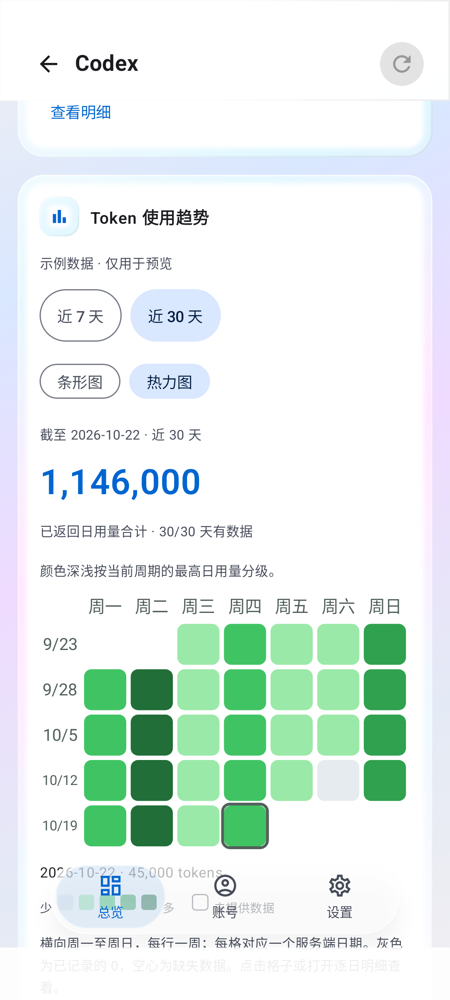

<p align="center">
  <picture>
    <source media="(prefers-color-scheme: dark)" srcset="docs/assets/brand/quodex-horizontal-on-dark.svg" />
    
  </picture>
</p>

<h3 align="center">所有 AI 用量，一眼就有数。</h3>
<p align="center">在 Android 上集中查看额度、订阅与 API 账单，把 Codex 用量放到桌面。</p>

<p align="center">
  <a href="https://tsonglew.github.io/quodex/">官网</a> ·
  <a href="https://github.com/tsonglew/Quodex/releases/tag/build-43213347536-1">下载 APK</a> ·
  <a href="docs/README.md">使用文档</a> ·
  <a href="https://github.com/tsonglew/Quodex/issues/new/choose">反馈问题</a>
</p>

**当前发布：0.1.0-alpha41** · Android 10+ · 简体中文 / English / 日本語 · [MIT](LICENSE)

Quodex 是开源的独立第三方工具，与 OpenAI、DeepSeek、OpenCode、Kimi、WorkBuddy、Cursor 或 xAI 无隶属关系。目前处于 Alpha 预发布阶段，账号覆盖及兼容接口范围见[支持说明](docs/SUPPORT.md)。

## 三个入口，日常所需

- **总览**：集中查看已连接服务的额度或余额，点服务标题进入明细。Codex 明细包含额度周期、重置时间、Token 趋势、重置卡和 API 福利查询。
- **账号**：按服务独立连接、重连与断开；可按订阅额度或 API 账单筛选，无需先登录 Codex。
- **设置**：管理外观、语言、刷新、桌面展示与应用更新。小组件和桌面额度图标统一位于“桌面展示”。

玻璃材质贯穿页面、导航和桌面组件；浅色、深色与跟随系统可选，也可启用“减少透明效果”。导航和近 7 / 30 天筛选的选中胶囊随操作平滑移动，支持中途反向，并遵循系统动画设置。

<p align="center"></p>

2026-11-12 · alpha41 debug / API 31 模拟器原生截图，未裁切或重绘，使用示例数据；不是正式签名 APK 的实录。[截图来源](docs/screenshots/liquid-selection-alpha41/README.md)

## 额度、趋势与桌面

| 功能 | 当前支持 |
| --- | --- |
| Codex 额度 | 按接口实际返回的周期展示剩余或已用百分比、重置时间；失败保留上次成功数据与时间。 |
| Token 趋势 | 近 7 / 30 天条形图与日历热力图，可切换图表并查看逐日明细；缺失数据与真实零值分开展示。 |
| 重置卡 | 查看可用张数，按需查询名称、状态、获得与到期时间；只读展示，使用卡片请前往 Codex。 |
| ChatGPT API 福利 | 查询 Pro / Business 资格、每周期赠送金额、可领取金额与到期时间；实验性只读接入，福利金额不是消费后余额。 |
| 桌面展示 | 标准额度、2×1 紧凑额度、2×2 的 30 天热力图，以及带百分比的桌面额度图标；额度组件可手动刷新。 |

桌面展示和后台额度刷新用于 Codex。其他服务在前台查询，不进入 Codex 的 Token 图表或桌面组件。Android 调度、省电与 Launcher 可能延迟后台刷新。[桌面帮助](docs/HOME_SCREEN_PERMISSION.md) · [后台指引](docs/BACKGROUND_GUIDE.md) · [API 福利范围](docs/API_CREDITS.md)

## 支持的服务

| 服务 | 查看内容与连接方式 |
| --- | --- |
| Codex | 额度、重置时间与 Token 趋势；在官方页面完成设备登录。 |
| DeepSeek | API 余额，按 CNY / USD 分别展示；API key 连接。 |
| OpenCode | Go 周期用量与重置时间；Console 工作区余额与可用额度，分别连接。 |
| Kimi | 会员用量使用 App 内官网登录；Code 与国内 / 国际 API 余额使用相应 API key。 |
| WorkBuddy | 国际站积分资源包，使用 App 内官网登录；国内站暂不支持。 |
| Grok / Cursor | 已迁移账号的共享订阅池与额外费用，使用 App 内官网登录；共享额度不重复计算。 |
| xAI / Cursor 团队 | xAI API 预付余额使用团队 Management key；Cursor 团队费用使用 Admin key。 |

Kimi、WorkBuddy、Grok / Cursor 在 App 内官方页面完成登录和验证，成功后自动读取，无需手工复制 Cookie 或 JSON。进入、返回或停留在 App 前台时自动检查，正常缓存五分钟；会话过期时提示重新登录，失败保留上次数据。服务端限流时遵守指定等待时间。

Google 邮箱输入页支持系统账号选择，网页表单可使用 Android 密码管理器；需要启用相应系统服务，不继承 Chrome 会话，也不会跳过 Google 验证。部分服务可能限制嵌入式登录。[接入步骤与账号范围](docs/SUBSCRIPTIONS.md)

## 下载与开始使用

1. 从[当前 Release](https://github.com/tsonglew/Quodex/releases/tag/build-43213347536-1)下载 APK，按需核对同页的 `SHA256SUMS` 与 `provenance.json`。
2. 在 Android 10 或更高版本安装，可先体验明确标注的示例模式，再到“账号”连接服务。Quodex 尚未上架 Google Play。
3. 在“设置 → 桌面展示”添加 Codex 额度组件、热力图或桌面额度图标。

应用内的“设置 → 应用更新”支持检查、下载、校验与安装；安装由 Android 系统弹窗确认。需要等待时会显示重试时间。正式发布包与 debug 包签名不同，不能直接互相覆盖。[安装帮助](docs/RELEASE_MATERIALS.md)

## 隐私与数据

凭据、API key 和订阅快照通过 Android Keystore 加密保存在设备上；网页登录状态由各服务独立的 WebView 私有目录管理。请求直接连接对应服务，无自建中转服务或自动诊断上传。

示例模式不发送真实额度请求。未知值不补零，不从百分比推算 Token 或费用。各服务分别断开，本机清理不等同于远程撤销授权。网页兼容接口、开发者 API 和真实账号的覆盖仍在验证中。

[隐私原文](app/src/main/res/raw-zh/privacy_notice.txt) · [数据流](docs/PRIVACY.md) · [支持范围](docs/SUPPORT.md)

## 本地开发

需要 JDK 17、Android SDK Platform 37.0 和 Build Tools 35.0.0。通过 `ANDROID_HOME` 或未提交的 `local.properties` 指定 SDK 路径。

```sh
git clone https://github.com/tsonglew/Quodex.git
cd Quodex
./gradlew testDebugUnitTest lintDebug assembleDebug
```

APK 输出到 `app/build/outputs/apk/debug/app-debug.apk`。使用 Kotlin、Jetpack Compose、Glance、Room、DataStore 和 WorkManager。安装要求 Android 10+，targetSdk 36。

专用测试环境可运行 `./gradlew connectedDebugAndroidTest`。CI 检查单元测试、lint、release 构建与六组 Android 设备；签名发布需主分支检查通过。[测试说明](docs/TESTING.md) · [CI 与发布](docs/CI_CD.md)

## 参与贡献

欢迎反馈问题、改进翻译或提交聚焦的 PR。问题请附版本、机型、Android / Launcher 版本与复现步骤，移除令牌、Cookie、授权码和个人信息。

[贡献指南](CONTRIBUTING.md) · [Issues](https://github.com/tsonglew/Quodex/issues) · [文档导航](docs/README.md) · [MIT License](LICENSE)
