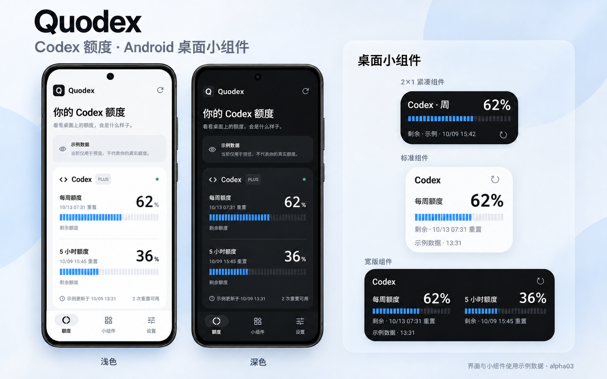

# Quodex

面向 Android 的 Codex 额度监控 App，参考 Nowdex 的额度速览与桌面小组件体验。Quodex 是独立第三方工具，与 OpenAI 无隶属关系。首版支持单 Codex 账号，先自用验证，再公开发布。

Quodex 使用新的 Android applicationId `com.tsonglew.quodex`。旧版 QuotaPal 不会原地升级为 Quodex；安装后需要重新连接账号，旧应用中的数据不会自动迁移。旧版更新检查地址也指向旧仓库，可能无法跟随 GitHub 的仓库改名跳转；请从新的 [Quodex Releases](https://github.com/tsonglew/Quodex/releases) 手动下载。两者可以暂时并存，确认新版本正常后再手动卸载旧版。

基于原生界面截图合成的展示效果图，额度均为示例数据。[查看原生截图](docs/SCREENSHOTS.md)。

当前开发版本为 `0.1.0-alpha21`，新增账号 token 用量趋势：展示服务端每日总量、近 7／30 天图表、累计用量与逐日明细，缺失日期明确标注，统计请求失败保留上次数据。该兼容接口尚待真实账号验收；未提供输入／输出／缓存细分或费用估算。

同时包含 alpha20 的应用更新提醒：后台目标间隔 12 小时检查 GitHub，发现同签名、更高版本时通知一次，点击进入发布下载页。设置内可关闭自动检查、手动检查及开启系统通知。旧版需先手动安装支持该功能的签名版本，后续升级才会收到提醒。

本轮还按 Android 官方指南优化界面：固定刷新入口、保留每页浏览位置、整行可点的设置开关、可换行的大字体布局、宽屏侧边导航，以及对比更清楚的浅深色主题。设计依据和验收范围见 [UI/UX 优化](docs/UI_UX.md)。

此前 alpha19 的小组件在 Android 12 及以上改用直接接收点击的透明 TextView，分开处理打开与刷新；固定 Glance 1.1.1 的布局覆盖由构建检查保护。最终候选已通过 API29／37 各 16 项模拟器回归，以及 API37 两项真实 TalkBack 探索／双击专项。小米完整 preview 的标题、时间、刷新手指点击与外观已验收；示例模式刷新跳过联网且不更新时间，正式签名覆盖升级与真实账号刷新仍待验收，见 [验证记录](docs/VALIDATION_XIAOMI_WIDGET_TOUCH.md)。alpha17 已新增诊断报告的系统后台受限标记，帮助排查后台刷新延迟。既有 alpha16 的 [PR #16 六组 CI](https://github.com/tsonglew/Quodex/actions/runs/38037325156) 已通过，覆盖 API 29／31／35／36／37.0／37.2。已提供本机诊断报告、最近 7 天的请求与刷新统计、后台任务状态，以及分品牌后台引导和小组件即时手动刷新。alpha16 修正诊断弹窗的主线程约束，固定签名覆盖升级已通过，验证记录见 [alpha16](docs/VALIDATION_ALPHA16.md)。真实账号续期、OEM 后台恢复和长期自用仍待验收。

已核验版本：[0.1.0-alpha17 预发布](https://github.com/tsonglew/Quodex/releases/tag/v0.1.0-alpha17)。

合并到 master 后自动运行完整 CI，生成固定签名 APK 并上传 [GitHub Releases](https://github.com/tsonglew/Quodex/releases)。每次构建以 `build-<runId>-<attempt>` 创建独立预发布，附 APK、SHA256SUMS 和来源信息，保留历史包；Actions 中的 `android-signed-apk` 同时保留 14 天。正式版本仍可按版本 tag 发布。

- [开发计划](docs/DEVELOPMENT_PLAN.md)
- [开发与验收 checklist](docs/DEVELOPMENT_CHECKLIST.md)
- [GitHub milestones](https://github.com/tsonglew/Quodex/milestones)
- [实时开发进度](docs/PROGRESS.md)
- [CI/CD、预览 Deployments 与签名发布](docs/CI_CD.md)
- [隐私说明与数据流](docs/PRIVACY.md)
- [后台更新引导](docs/BACKGROUND_GUIDE.md)
- [小组件刷新修复验证](docs/VALIDATION_ALPHA06.md)
- [Codex 接入证据与边界](docs/CODEX_INTEGRATION.md)
- [接口兼容与故障维护策略](docs/COMPATIBILITY_POLICY.md)
- [界面规格](docs/UI_SPEC.md)
- [测试与自用验收](docs/TESTING.md)
- [历史修复 PR](https://github.com/tsonglew/Quodex/pull/8)
- [alpha03 验证记录与 2×1 安装包](docs/VALIDATION_ALPHA03.md)
- [alpha02 验证记录](docs/VALIDATION_ALPHA02.md)
- [首版验证与 APK 校验和](docs/VALIDATION.md)
- [原生页面和组件截图](docs/SCREENSHOTS.md)
- [产品简介、发布素材与使用帮助](docs/RELEASE_MATERIALS.md)

Android 10+，Kotlin 2.1.21、Compose、Glance、Room、DataStore 和 WorkManager。固定构建链为 AGP 8.10.1、Gradle 8.11.1、JDK 17，compileSdk／targetSdk 36。

已有 Android SDK 与 JDK 17 时执行 `./gradlew testDebugUnitTest lintDebug assembleDebug`。APK 位于 `app/build/outputs/apk/debug/app-debug.apk`。有设备或模拟器时执行 `./gradlew connectedDebugAndroidTest`。GitHub Actions 会保存 APK、测试报告及原生截图。

设备登录由用户在 OpenAI 页面完成，Quodex 不收集密码。示例模式须主动选择并明确标注，不执行额度请求。凭据通过 Android Keystore 加密保存在本机；退出清理本机连接，远程授权不会因此自动撤销。

当前账号覆盖、刷新限制和未完成验收见 [支持范围与已知限制](docs/SUPPORT.md)。

普通版与横条版桌面小组件都支持手动刷新：点击 `↻` 原地刷新额度，刷新期间显示 `…`，结果同步到其他已添加的小组件。点击小组件的标题、额度或其他主体区域会打开 Quodex；未连接账号时，刷新入口也会打开应用以完成连接。示例模式不请求真实额度。

设置中的“显示剩余额度”会同步到所有桌面小组件，开启显示剩余、关闭显示已用，并保留各组件主题。单个组件仍可独立配置；之后切换 App 中的全局开关会再次统一显示方式。
