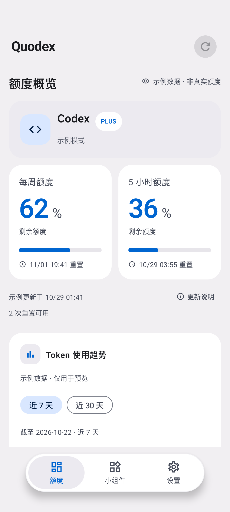
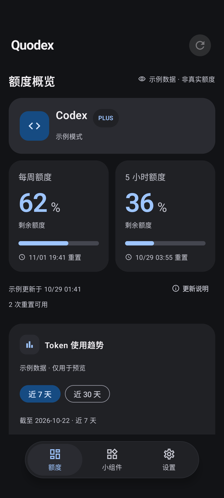

# Android 仪表盘与应用内更新

开发分支记录，2026-10-29；尚未发布到 GitHub Releases。

本次合入版本为 `0.1.0-alpha24`（versionCode 24），便于已安装版本检测到更新。

## 界面

参考 [FlClash v0.9.2 的官方 Android 安装包](https://github.com/chen08209/FlClash/releases/tag/v0.9.2)，在本地 Android 模拟器中核对默认界面后，用现有 Jetpack Compose 实现；不引入 Flutter 或第三方图像资源。

- 浅灰背景、蓝色强调色与 24dp 圆角面板；深色模式采用中性深灰和浅蓝。
- 独立的账号状态面板和双列额度卡片。窄窗口、大字体或单个周期时改为单列，未知、受限、旧数据和示例说明继续保留。
- 手机采用居中的悬浮胶囊导航：最大宽 320dp、阴影、整项选中背景、系统手势区避让。导航高度随字号变化，滚动视口同步避让，自动滚动到的按钮不会被导航遮住。宽屏保留侧边导航。
- Token 图表优先于易读单位开关；设置采用图标标题和胶囊选项。所有页面保留独立浏览位置。
- Compose 和 Glance 共享新配色；应用品牌图标继续使用已有流线 Q 资源。

| 浅色 | 深色 |
| --- | --- |
|  |  |

[设置](screenshots/flclash-android/settings-light.png) · [小组件页面](screenshots/flclash-android/widgets-light.png) · [320dp / 200% 字体](screenshots/flclash-android/large-font.png)。截图来自本次 API 37 模拟器构建，额度均为示例数据。大字体截图为滚动中的页面。

## 应用内更新

通知打开 Quodex。用户在首页提示或设置中点击“下载并安装更新”，在 App 中查看进度、取消和重试；下载并校验后点击“立即安装”。首次进入 Android 的安装来源授权页，授权返回后继续系统安装确认。安装始终由用户确认。

下载使用独立的公共 HTTP 客户端，只接受当前仓库的发布附件与 GitHub 文件域名的 HTTPS 跳转；不携带 Codex 凭据。GitHub asset digest 提供 SHA-256，下载完成后再次检查包名、精确版本号、版本递增及当前安装签名。文件大小受上限与发布元数据约束，损坏／不完整文件不会进入安装流程。FileProvider 仅共享私有缓存的 updates 目录，并临时授权系统安装器读取。

下载由应用级协程管理，切换页面或重建 Activity 不会重复启动。进程被系统终止后可以重新点击更新入口：完整缓存重新校验后复用，未完成文件重新下载。旧版缓存缺少下载信息时重新检查公开发布信息，不拼接或猜测下载地址。

[下载完成](screenshots/flclash-android/update-ready.png) · [首次安装授权](screenshots/flclash-android/update-permission.png) · [Android 更新确认](screenshots/flclash-android/update-installer.png)

## 验证

- `./gradlew testDebugUnitTest lintDebug assembleDebug assembleDebugAndroidTest`：171 项单元测试通过；lint、debug APK 和 instrumentation APK 构建通过。
- API 37 [设备测试记录](diagnostics/flclash-ui-update/device-tests.txt)：24 项通过、2 项按设备条件跳过，包含安装器专项及额度、Token、设置、示例／退出、诊断、通知与导航回归；窄屏 200% 字体和悬浮栏内容避让已覆盖。宽屏与通知允许分支按设备条件跳过，未声称本次覆盖所有 Android 版本。
- 下载专项覆盖可信跳转、进度、SHA-256、长度／截断／超限、恶意地址、取消阻塞连接及重新下载。
- 安装器专项使用本地生成的同签名、更高版本最小 APK，验证缓存、FileProvider、来源授权与系统确认页面；测试取消安装，不将空测试包覆盖到应用，也不将该结果视为正式签名发布包的完整升级验收。

复现安装器专项（仅限自有模拟器）：

```sh
scripts/update_fixture.sh
adb -s emulator-5556 shell mkdir -p /sdcard/Android/data/com.tsonglew.quodex/files
adb -s emulator-5556 push .tools/update-fixture/candidate.apk /sdcard/Android/data/com.tsonglew.quodex/files/candidate.apk
# 权限改变可能终止应用，因此必须在启动 instrumentation 之前执行。
adb -s emulator-5556 shell appops set com.tsonglew.quodex REQUEST_INSTALL_PACKAGES deny
adb -s emulator-5556 shell am instrument --no-hidden-api-checks -r -w \
  -e updateFixture /sdcard/Android/data/com.tsonglew.quodex/files/candidate.apk \
  -e class com.tsonglew.quodex.InAppUpdateDeviceTest \
  com.tsonglew.quodex.test/com.tsonglew.quodex.QuotaTestRunner
```

平台依据：[安装来源权限](https://developer.android.com/reference/android/content/pm/PackageManager#canRequestPackageInstalls())、[FileProvider 临时 URI 读取权限](https://developer.android.com/reference/androidx/core/content/FileProvider)。
