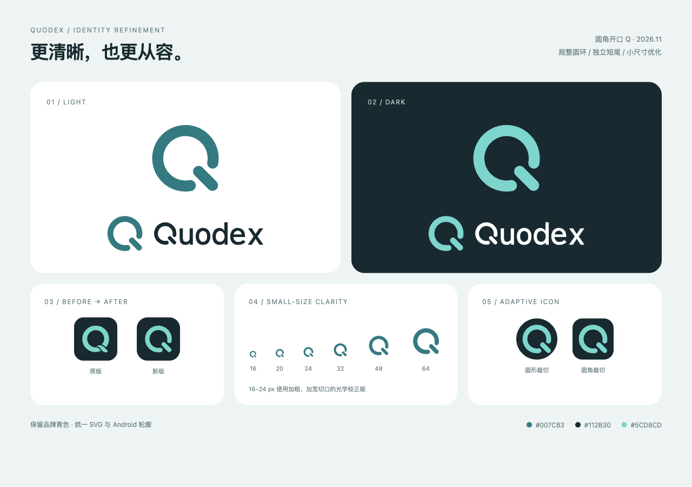

# Quodex 品牌与配色

2026-11-03 当前工作区采用圆角开口 Q：规整圆环、圆角端点与独立的 45° 短尾。参考 [Iconly 的 App 图标展示](https://iconly.design/)中简洁轮廓、集中视觉重心和小尺寸识别的做法，在原有 Q 与深海青配色上优化；全部轮廓为本项目绘制。Quodex 是独立第三方工具；标志与字标用于本项目，不使用 OpenAI 官方标志或暗示官方授权。

## 轮廓与小尺寸

- 常规符号使用 256 × 256 画布，圆心 `(128, 128)`、环形中心线半径 80、笔画宽度 32；右下切口两端为半圆，短尾方向为 45°。
- 用宽度一致的短尾替换原来的细尖流线连接，保留环与尾之间的清晰负形。字标中的 Q 同步更新，其余字母的轮廓与字距沿用原版。
- 16–24 px 使用独立光学校正版：笔画宽度 34、环形中心线半径 79，切口角度扩大，短尾略缩短，避免像素缩放时粘连。
- App 图标使用深墨底、亮青符号和 64/256 圆角；SVG 预览与 Android 普通图标使用相同圆角。Android 自适应图标由系统提供外形裁切。

## 颜色角色

| 用途 | 颜色 |
| --- | --- |
| 浅底主标志、官网强调色 | 深海青 `#007C83` |
| 字标、默认图标背景、深色卡片 | 深墨色 `#112B30` |
| 默认图标 Q、深底品牌符号 | 亮青色 `#5CD8CD` |
| 浅色页面背景 | 浅青白 `#EEF8F7` |
| 深色页面背景 | `#0B1C20` |
| 浅色卡片、反白标志 | `#FFFFFF` |

上表为品牌与官网配色。当前 App 与 Glance 组件的蓝色主题由 `Theme.kt` 定义，见 [界面说明](ANDROID_DASHBOARD_UPDATE.md)，不将品牌青色描述为当前 App 主色。错误与警告保留独立语义色。亮青标志配深色背景；浅色背景使用深海青。标志采用纯色，不增加描边、渐变或填满切口。

## 资产来源与使用

仓库可直接引用的 SVG 位于 [docs/assets/brand/](assets/brand/)。使用 `python3 scripts/generate_brand_assets.py` 从同一份几何定义生成 9 份 SVG 与 3 份 Android VectorDrawable，不依赖字体或第三方绘图库。历史流线 Q 已由当前圆角开口 Q 替换；App 配色角色继续沿用 [UI/UX](UI_UX.md)。

| 场景 | 资产 |
| --- | --- |
| 浅底横向组合 | [quodex-horizontal-color.svg](assets/brand/quodex-horizontal-color.svg) |
| 深底横向组合 | [quodex-horizontal-on-dark.svg](assets/brand/quodex-horizontal-on-dark.svg)，透明底，需配深色背景 |
| 默认 App 图标 | [quodex-app-icon.svg](assets/brand/quodex-app-icon.svg)，深墨底配亮青 Q |
| 独立符号 | [浅底常规](assets/brand/quodex-symbol.svg)／[深底常规](assets/brand/quodex-symbol-on-dark.svg)；16–24 px 使用 [浅底小尺寸](assets/brand/quodex-symbol-small.svg)／[深底小尺寸](assets/brand/quodex-symbol-small-on-dark.svg) |
| 网页图标 | [favicon SVG](assets/brand/quodex-favicon.svg)、[maskable SVG](assets/brand/quodex-maskable.svg) |

Android 工作区资源为 `app/src/main/res/drawable/ic_quodex.xml`、`ic_quodex_foreground.xml` 与 `ic_quodex_monochrome.xml`；这些路径说明接入位置，公开 APK 是否包含新图标仍以发布记录为准。

SVG 已将符号与字标转成填充路径，无字体依赖；保留画布留白、比例和字距。横向组合建议宽度至少 220 px。Android adaptive icon 与网页 maskable 版本使用各自安全区，不互换裁切方式。Android 符号最大半径约 32.9 dp，位于中央 66 dp 安全圆内；网页 maskable 符号最大半径约 96 px，位于 256 px 画布中央 40% 半径安全区内。

## 当前显示与发布边界

[截图索引](SCREENSHOTS.md)保留此前深海青真实界面与原生组件截图、测试轮次和 APK 哈希；这些历史截图仍可能显示旧版流线 Q。本文预览为当前矢量资源的渲染，包含深浅底、16–64 px 尺寸与自适应裁切模拟，不代表设备截图或公开发布。

2026-11-03 本地验证：`:app:assembleDebug` 与 `:app:lintDebug` 通过；12 份 SVG/XML 均可解析，Android 与 SVG 符号路径一致，重复生成结果一致。预览已检查深浅背景与小尺寸，采样轮廓验证自适应与 maskable 安全区。本轮未进行真机安装验收；公开 Release 是否包含新版图标以发布记录为准。
