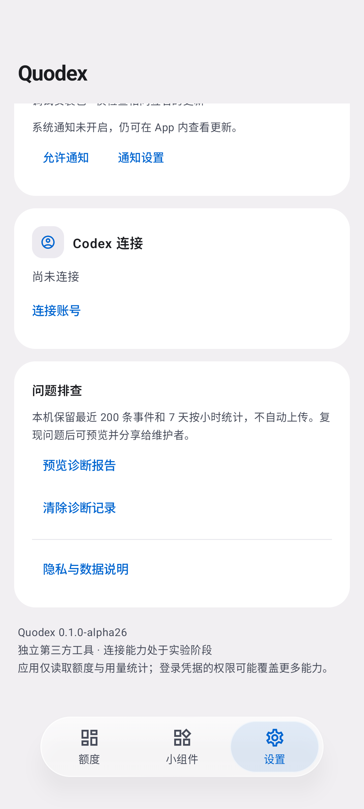

# 液态玻璃风格导航

alpha26 将底部胶囊改为覆盖在滚动内容上的玻璃材质。页面延伸到屏幕底部，去掉原先整条占位区域；仅在内容末尾留出导航高度，最后一项仍能滚到胶囊上方。胶囊外侧不拦截滑动，键盘焦点请求也按可见区域避让。

Android 12 及以上实时采样页面图层，在胶囊内轻微放大、模糊并叠加半透明底色和边缘高光；图标、文字保持清晰，选中背景使用弹簧动画横向移动。Android 10–11 使用半透明材质兼容显示。沿用系统动画缩放、三种语言和宽屏侧栏，没有增加外部图形依赖。

图层记录遵循 [Compose 图形接口](https://developer.android.com/develop/ui/compose/graphics/draw/modifiers#composable-to-bitmap)，只记录页面，不把导航自身加入背景，避免反馈和重复文字。复用 GPU 图层，不逐帧截屏或分配位图。

## 实际界面

以下为本地 API 37 模拟器的应用截图，额度为示例数据。

| 浅色 / 内容穿过胶囊 | 深色 / 图表延伸到胶囊下方 | 滚动到底部 / 页尾可见 |
| --- | --- | --- |
|  |  |  |

## 验证

- Debug 构建及 lint；176 项 JVM 测试；Release lint 与 R8 打包通过。
- API 37 本地完整设备测试返回 `OK (65 tests)`，平台限定用例遵循现有条件跳过。
- 更新导航回归检查：视口延伸到胶囊下方、侧边真实滑动可滚动页面、页尾能滚到胶囊上方。
- 页面自动化定位先滚动到视口，再避开胶囊覆盖区，保留真实触摸点击；对话框与独立组件测试不受影响。
