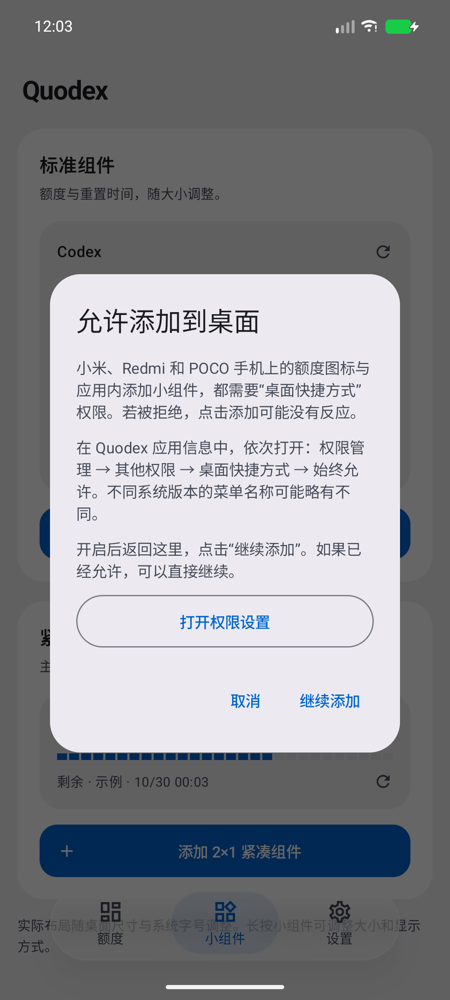

# 小米桌面添加权限引导

alpha27 在小米、Redmi、POCO 的三个入口增加点击时提醒：桌面额度图标、标准小组件、紧凑 2×1 小组件。已固定图标的「更新桌面图标」继续直接更新。其他品牌保留原有的系统添加流程。

弹窗说明「桌面快捷方式」权限也影响应用内添加小组件，提供：

- **打开权限设置**：通过 Android 标准应用信息 Intent 打开 Quodex 的系统设置。再进入「权限管理 → 其他权限 → 桌面快捷方式 → 始终允许」。菜单名称可能随系统版本变化。
- **继续添加**：已授权时继续刚才选中的添加操作；不修改系统权限。
- **取消**：关闭提醒，不发出添加请求。

从设置返回后保留提醒；保存的目标能在页面重建后恢复。不会把一次设置访问记为「已授权」，也不会自动重复发出添加请求。厂商权限没有受支持的 Android 公共查询接口，因此这里是权限说明，不声称已检测到拒绝；未使用私有 AppOps 编号或反射读取权限。文案包含简体中文、英文和日文。

## 实机原因与边界

2026-10-29，在 Xiaomi 17 Ultra、Android 17/API 37、HyperOS OS4.0.4.0.XPACNXM、Quodex alpha26 上复现：

1. 「添加标准组件」与「添加到桌面」点击后都没有出现添加确认，系统 AppOps 10017 的拒绝时间随每次点击刷新。手机的系统框架把 10017 定义为 `OP_INSTALL_SHORTCUT`，权限管理显示「桌面快捷方式：拒绝」。
2. 在系统界面将 Quodex 的这一项改为「始终允许」后，额度图标成功出现在桌面，应用收到固定成功状态。
3. 标准小组件出现小米添加确认，完成 Quodex 配置保存，并由系统记录为绑定到 `com.miui.home`、具有 RemoteViews 的小组件。已有紧凑组件保留。新标准组件在桌面中的具体位置未做视觉验收。

这证明该系统版本的两个添加入口受同一权限影响，不代表所有小米系统都默认拒绝。正式应用和账号数据没有被覆盖或清除，临时独立诊断工具已移除。新引导的自动化验证使用受控模拟器，不把上述 alpha26 实机排查当作 alpha27 的实机 UI 验收。

## alpha27 自动化验证

本地 `testDebugUnitTest` 176 项通过，`lintDebug`、debug／androidTest 构建及 R8 发布构建通过。API 37 的新引导专项 3/3 通过；与桌面图标、既有 UI 一同运行时 11 项通过、1 项宽屏用例因当前手机尺寸按条件跳过。验证覆盖三个实际入口、应用信息 Intent 的目标包、设置访问不视为授权、待添加的紧凑组件在保存状态恢复后保持正确、取消无添加，以及其他品牌直接继续。

下面是受控模拟器中强制开启小米引导的实际截图，仅含示例数据：

