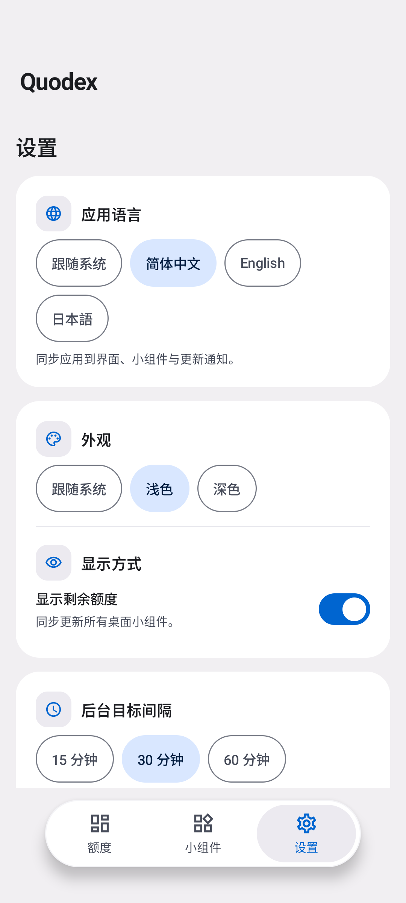
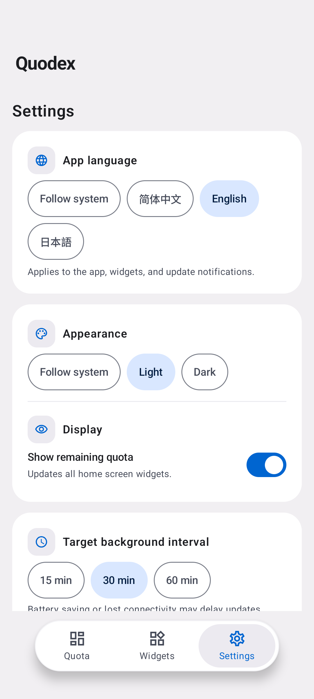
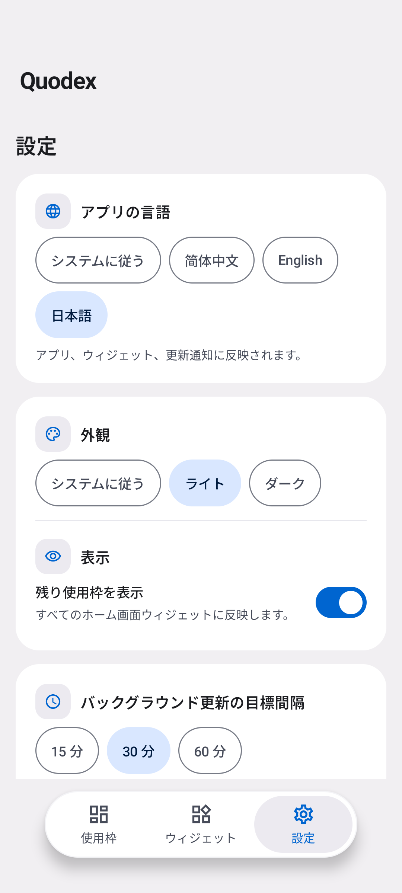
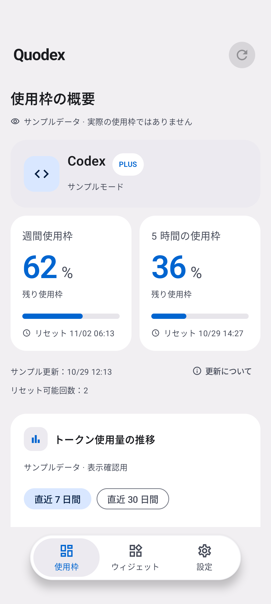
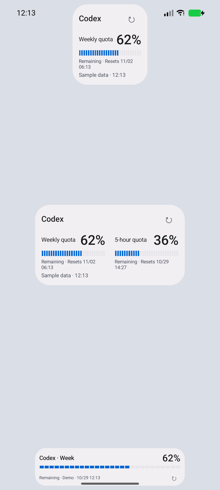
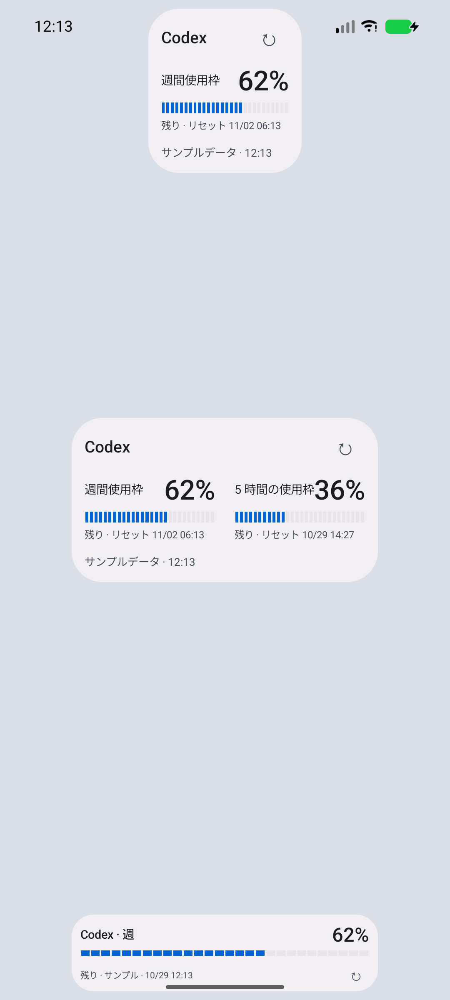

# 简体中文、English、日本語

alpha25 新增设置 → 应用语言，提供“跟随系统”、简体中文、English、日本語。默认跟随系统；其他系统语言回退到英文。选择会保存在本机，重启后继续生效。Android 13 及以上也可通过系统的应用语言设置更改。

翻译覆盖三个主页面与悬浮导航、登录和错误提示、Token 趋势、更新下载和安装提示、后台引导、隐私说明、桌面小组件和额度图标。已添加的小组件与当前显示的更新通知会随语言切换刷新；数据、数值和组件外观设置保持原样。服务端提供的自定义功能名、品牌名称与技术诊断字段不翻译。

| 简体中文 | English | 日本語 |
| --- | --- | --- |
|  |  |  |

| 日语额度页 | 英语桌面组件 | 日语桌面组件 |
| --- | --- | --- |
|  |  |  |

截图于 2026-10-29 在 API 37 模拟器获取，使用明确标注的示例数据；组件图片来自真实 AppWidgetHost 测试界面。

## 实现与维护

- 使用 Android 字符串资源：默认 `values` 为英文，`values-zh` 为简体中文，`values-ja` 为日文。三个目录各有 323 条翻译，默认目录另有 3 条不翻译的品牌名。格式参数使用位置占位符，并由测试核对完整性和参数一致性。
- 通过 AppCompat 应用语言 API 和 `locales_config.xml` 管理语言；Android 12 及以前由 AndroidX 保存选择。Worker、Glance 和快捷方式使用应用语言资源上下文，避免继承系统语言而与页面不一致。
- 配额周期名称按当前语言在展示时生成，兼容旧版中文快照；不需要清空缓存或为翻译重新获取额度。临时错误保留资源标识，到显示时才解析。
- 隐私说明随 APK 打包为三份本地资源，离线可读。语言偏好不发送给账号或更新服务。

Android 官方依据：[应用语言](https://developer.android.com/guide/topics/resources/app-languages)、[ContextCompat](https://developer.android.com/reference/androidx/core/content/ContextCompat)。

## 本地验证

- 176 项 JVM 测试通过，包含翻译完整性、占位符、旧缓存兼容、错误和桌面图标文案测试。
- Debug / Release Lint、Debug / AndroidTest / R8 Release 构建通过；46 项交付脚本测试与 ShellCheck 通过。
- API 37 全新安装的 65 项设备测试全部通过；其中新增 2 项设备测试验证实际点击语言选择器、Activity 重建、跟随系统，以及三个已有组件自动重绘和示例数据不联网。旧额度页测试已改为匹配翻译后的周期名，专项 9 项复测全部通过。
- 实际安装经 R8 处理的 Release APK，通过系统 UI 操作切换日语、强制停止后冷启动、确认日语及示例状态保留，再切换中英、深色模式、隐私和退出流程；结果 `RELEASE_SMOKE_OK`。
- 全新安装 CI 曾暴露测试预设中文与 AndroidX 首次迁移的竞态，以及旧 Android 独立组件测试的语言初始化遗漏，已修正测试初始化；没有放宽断言。
- API 36 再次出现系统级 “System UI isn’t responding” 弹窗，遮挡后续设备测试；为该组分配 4 GB 模拟器内存，并保留 ActivityManager / WindowManager / InputDispatcher / lmkd 诊断日志。六组设备 CI 和合并后的签名发布结果以对应 GitHub Actions 记录为准。
