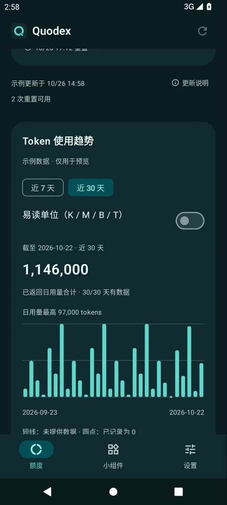

# Quodex 动效说明与录屏

## alpha41：流动选中态

参考 [kev 的 Liquid UI 演示](https://x.com/koppkev/status/2120471771602092136)，底部「总览／账号／设置」和 Codex 的 7／30 天筛选使用共享胶囊背景。保留主分支的玻璃背景、描边、多语言和图表模式；文字、图标与点击区域保持稳定。

- Compose 弹簧阻尼 0.85、刚度 650，主要移动约 200–300ms。速度驱动有限拉伸，静止后恢复；连续点击从当前位置转向。
- 实际控件边界决定位置与宽度，支持 RTL。初次布局、窗口变化或选项跨行直接定位；筛选点击高度至少 48dp。
- 逐帧状态只在绘制阶段读取，无循环动画、新滤镜或依赖；遵循系统动画倍率，包括 0。
- 页面滚动、筛选周期、热力图入口和服务端数值保持原有行为；宽屏沿用侧栏。

2026-11-12：在最新 master bafd4fe 上移植并验证，310 项 JVM 单测通过，debug/release 构建与 lint 通过；API 31 的 4 项动效专项、2 项页面回归、6 项 Token 检查通过。动效专项使用显式 1x/0x Compose 测试时钟，避免 CI 系统关闭动画后跳过中间帧；关闭原生触摸涟漪以隔离背景像素，页面回归保留涟漪。包含中途反向、深色 RTL、日文导航两倍字体换行、两倍字体与中途窗口变窄；导航项共享同一行高度，避免长标签改变选中胶囊高度。没有新增真机性能或宽屏验证结论。完整六组设备与 release 冒烟结果以关联 PR 检查为准。

[alpha41 原生截图与来源](screenshots/liquid-selection-alpha41/README.md)。源码版本与已发布 APK 需分别核对 [Releases](https://github.com/tsonglew/Quodex/releases)。

## alpha22 历史动效

[在官网播放动效](https://tsonglew.github.io/quodex/#motion) · [打开 MP4](assets/motion/quodex-motion.mp4) · [下载 alpha22](https://github.com/tsonglew/Quodex/releases/tag/build-40285639293-1)

alpha22 为页面切换、额度变化和图表筛选加入 Compose 原生动效。连接按钮借鉴 [React Drops · Chromatic Button](https://reactdrops.dev/components/button/chromatic-button) 的入场、光泽与触感思路，沿用 Quodex 的深海青配色。

## 动作与节奏

以下时长以 Android 系统动画倍率 1 为准。

| 场景 | 动作 | 时长或幅度 |
| --- | --- | --- |
| 进入页面 | 淡入并轻微上移，顶部操作和导航保持固定 | 320ms、12dp |
| 连接按钮进入 | 等待 120ms 后扫过一次柔和高光 | 850ms |
| 按下连接按钮 | 轻微缩小，松开后弹性恢复 | 缩至 97.5% |
| 额度条首次显示或数据改变 | 平滑填充或过渡到实际目标值 | 520ms |
| Token 图表首次进入、切换 7／30 天或日期范围改变 | 柱条从底部错峰展开 | 总计 600ms |
| 同一日期范围的 Token 数据更新 | 柱高平滑过渡到新值 | 380ms |

柱条展开时，每根柱的生长过程为 420ms，第一根到最后一根的启动间隔合计 180ms。相同数据刷新、更新时间文案变化和易读单位切换不会重新播放入场动画；切回页面时仍保留原来的滚动位置和趋势周期。

## 数据与系统设置

动画只改变视觉过渡。百分比文字、Token 数值和无障碍描述始终采用实际数据，不播放从零计数或其他临时数值。缺失数据仍显示短线，明确为零的记录仍显示圆点。

所有动效遵循 Android 系统动画时长缩放；倍率为 0 时直接完成，内容和操作保持可用。按钮扫光只播放一次，没有持续循环的装饰动画。每帧更新在绘制或图层阶段执行，避免重复布局整个页面。

## 录屏来源与验证

视频于 2026-10-26 在 Android 12 / API 31 模拟器录制，由实际屏幕画面剪辑而成。素材使用 alpha22 发布前的 debug 构建，与公开版采用相同的最终动效实现；显示内容全部为示例数据，不属于签名 alpha22 APK 的实录。视频展示页面淡入、按钮扫光、额度条填充和 Token 图表周期切换；按压回弹及数据更新行为见上表。

发布前的 API 31 手机检查在动画倍率 1 下通过 14 项额度、页面、Token 与示例流程回归；倍率 0 下另通过示例流程和独立滚动恢复 2 项。宽屏专项在该轮因手机窗口条件跳过，真机验证范围另行记录。完整来源与历史截图见[截图索引](SCREENSHOTS.md)，界面规则见[界面规格](UI_SPEC.md)。

alpha22 已通过发布流程，固定签名 APK、SHA256SUMS 与 provenance.json 位于 [build-40285639293-1](https://github.com/tsonglew/Quodex/releases/tag/build-40285639293-1)。录屏用于观看动效，发布产物用于核对版本、签名和来源提交。
