# Android 原生截图与动效录屏

## alpha31 日历式热力图（2026-10-31）

[App 与桌面组件截图](TOKEN_HEATMAP.md#验证)来自 alpha31 debug / API 37 模拟器，使用示例数据。App 为 Compose 原生屏幕捕获，组件由真实 AppWidgetHost 绘制并原样保存；不是设计稿或真实账号数据。热力图按周一至周日横向铺满，App 高度随周数变化，2×2 与宽版组件保留更多图表空间。条形图布局未改，继续使用已标注来源的 alpha30 截图。

## alpha22 动效录屏（2026-10-26）

[在官网播放动效](https://tsonglew.github.io/quodex/#motion) · [打开 MP4](assets/motion/quodex-motion.mp4) · [动效参数与行为](MOTION.md)

<a href="https://tsonglew.github.io/quodex/#motion">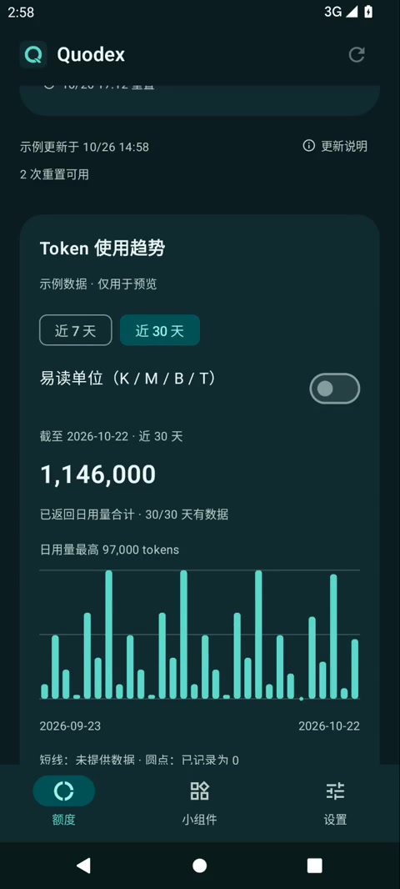</a>

视频由 Android 12 / API 31 模拟器的实际屏幕录制剪辑而成，包含页面淡入、连接按钮扫光、额度条填充和 7／30 天 Token 柱图切换。录制使用 alpha22 发布前的 debug 构建，与发布版采用相同的最终动效实现；全部为明确标注的示例数据。这段素材不属于签名 alpha22 APK 的实录。

上述界面与动效现已随 [alpha22 · build-40285639293-1](https://github.com/tsonglew/Quodex/releases/tag/build-40285639293-1) 公开发布。录屏说明视觉行为，安装包版本、签名、校验和与源提交以该 Release 附件为准。以下截图继续保留各自的拍摄日期、构建与验证记录。

## 小组件与设置页统一（2026-10-23）

两页沿用新版额度首页的圆角面板、字号和留白，保留现有 Logo 与深海青配色。小组件页分为标准、紧凑两张预览卡，各有系统添加入口；设置页优先展示外观和显示方式，将刷新及更新的详细说明按需展开。

以下原图来自 `0.1.0-alpha21-unified-ui-v2` 本地 debug APK，在 Android 12 / API 31 的临时 Pixel 6 模拟器中捕获。全部为明确标注的离线示例数据，没有登录真实账号，也没有合成或裁切。

| 页面 | 浅色 | 深色 |
| --- | --- | --- |
| 小组件 | 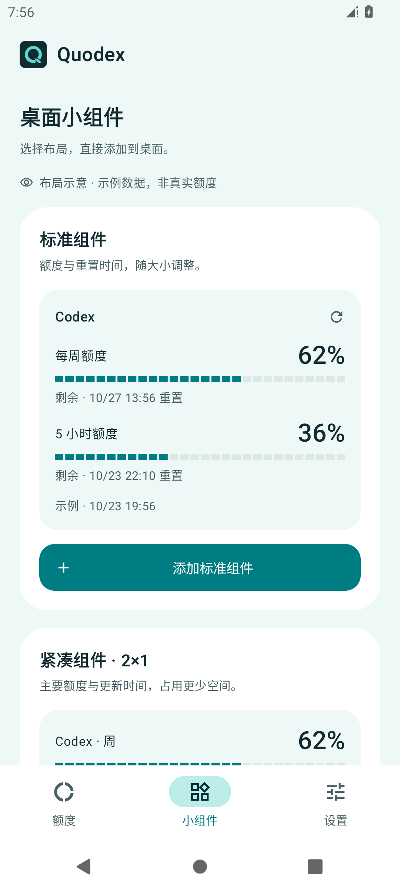 | 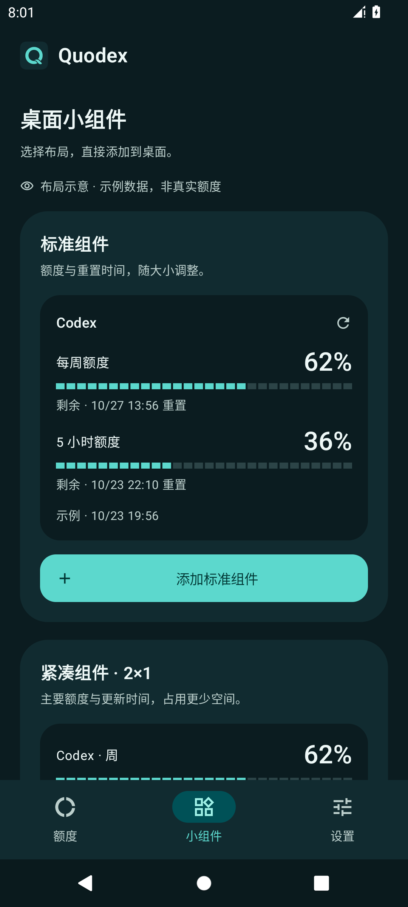 |
| 设置 | 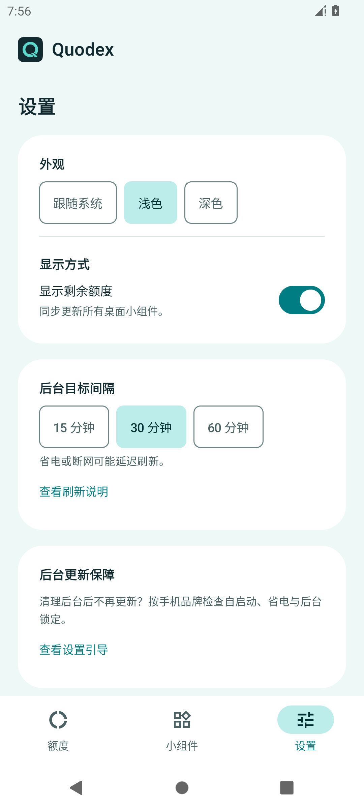 | 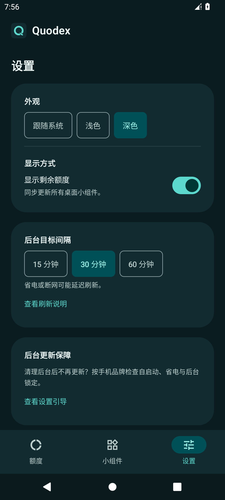 |

本地验证：155 项 JVM 测试、46 项交付脚本测试通过，lint 为 0 错误、54 项现有警告。API 31 设备回归 22 项通过，1 项宽屏测试因手机尺寸跳过；调整换行间距后再次通过 320dp、200% 系统字体专项。两种添加按钮均实测打开系统组件面板，刷新说明弹窗可正常打开和关闭。

APK SHA-256：`103210317eb8b455dcb1bb4d44ad93ab24eb3ee6b624b0be4ded147ef52d634f`。这是本地界面体验包；[CI 修复 PR #30](https://github.com/tsonglew/Quodex/pull/30) 只包含测试对模拟器 Launcher 弹窗的恢复处理，不包含这些界面改动。原始日志与 APK 清单位于本地 `artifacts/pages-v2/`。

## 深海青主题初版（2026-10-23）

以下图片来自 `0.1.0-alpha21` 工作区的本地 debug 构建，在 Android 12 / API 31、Pixel 6、420 dpi 的只读临时模拟器中直接取得。全部使用离线示例数据，未登录真实账号。图片原样复制到 `screenshots/deep-teal-api31/`，没有合成、裁切或重绘；网页中的宽度仅用于展示缩放。

这组图片记录发布前工作区的显示效果，截图本身不作为远端 CI 或正式签名验收的证据。相关界面现已随 alpha22 发布，公开安装包见[对应 Release](https://github.com/tsonglew/Quodex/releases/tag/build-40285639293-1)。

### 额度总览

| 浅色 | 深色 |
| --- | --- |
| 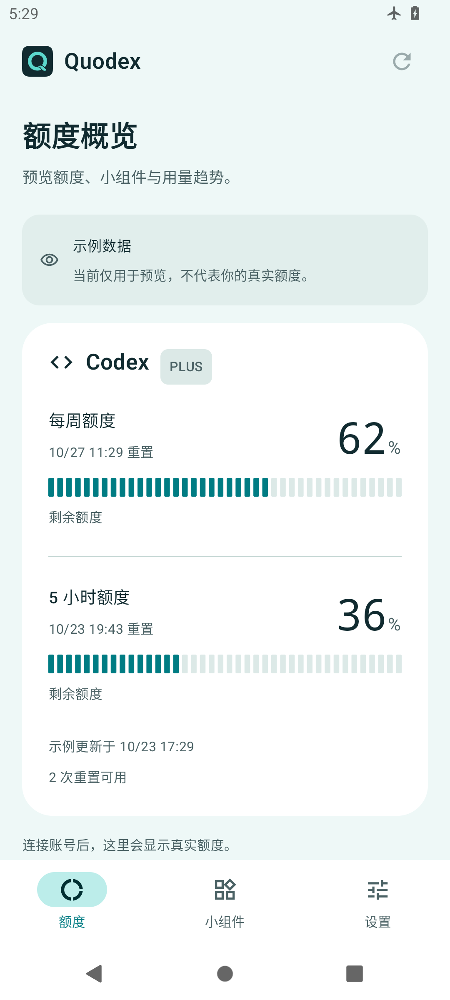 | 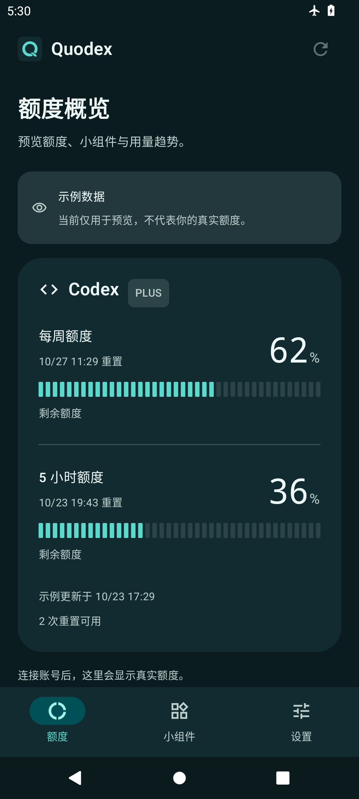 |

### Token 日用量趋势

本次截图均选中近 7 天，保留近 30 天入口；图中数值来自示例。实际功能按服务端日期汇总，缺失用短线、已记录为零用圆点表示，不从额度百分比估算 Token。

| 浅色 | 深色 |
| --- | --- |
| 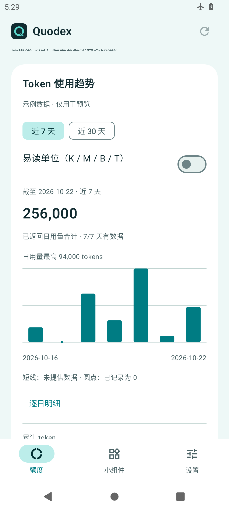 | 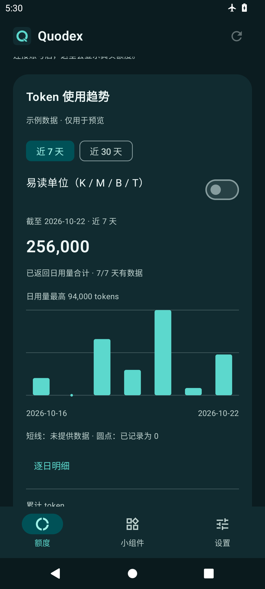 |

### 组件预览页与设置

| 页面 | 浅色 | 深色 |
| --- | --- | --- |
| App 内组件预览 | 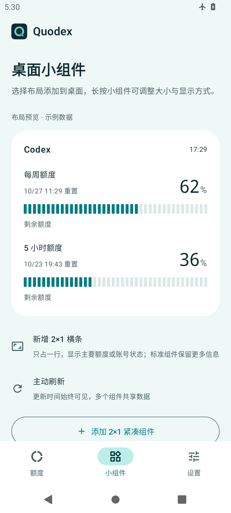 | 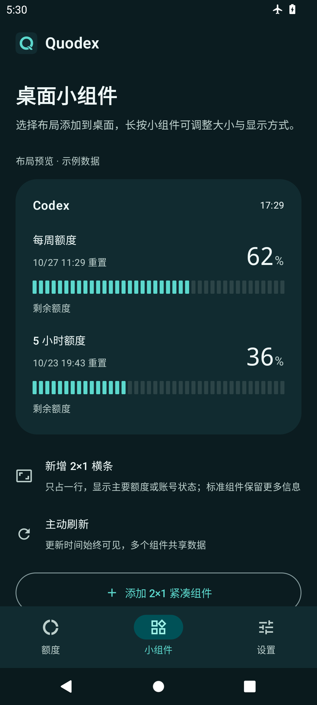 |
| 设置 | 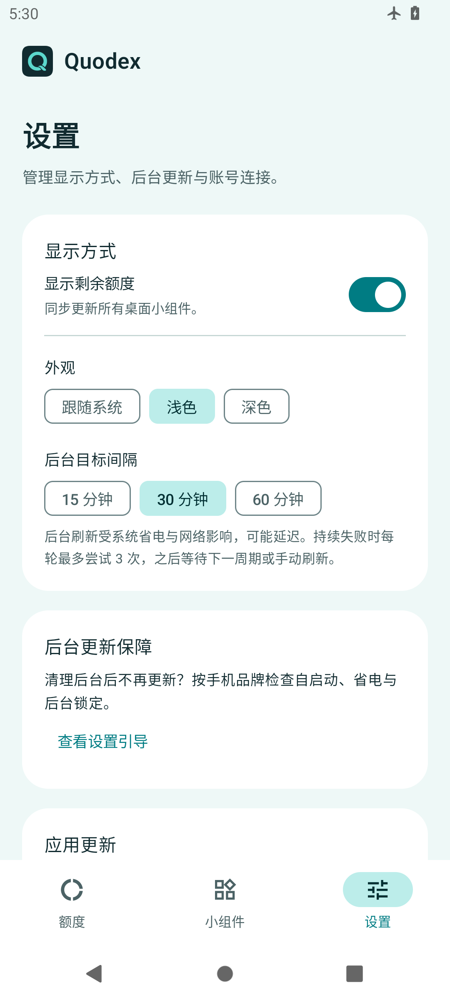 | 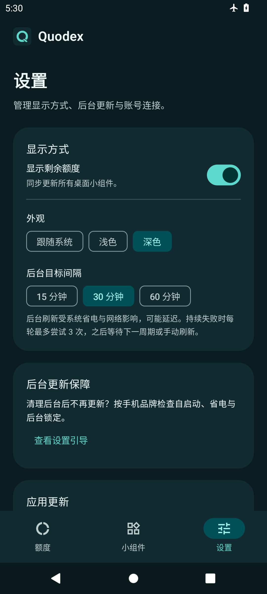 |

### 真实原生组件

由现有 `WidgetRenderTest` 通过真实 AppWidgetHost 渲染，再以 PixelCopy 截取。保留测试宿主边缘，尺寸按组件内容的 dp 标注；不把 App 内预览当作桌面组件截图。

| 140×150 dp 标准浅色 | 280×150 dp 宽版深色 | 140×230 dp 纵向浅色 |
| --- | --- | --- |
| 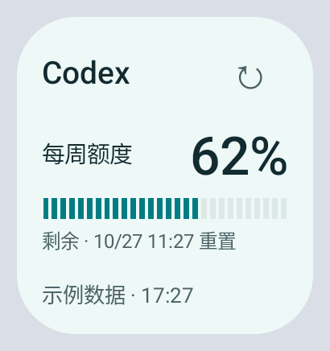 | 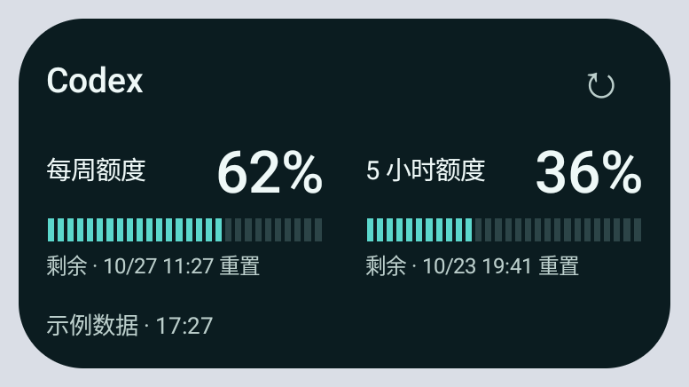 | 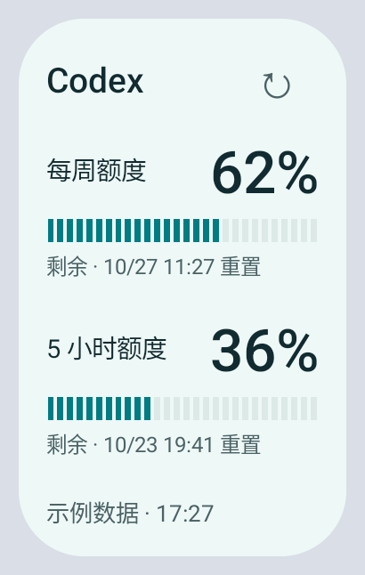 |

| 130×70 dp 单行浅色 | 140×70 dp 单行深色 |
| --- | --- |
| 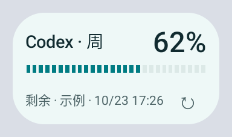 | 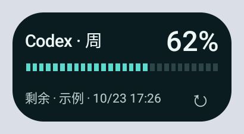 |

另有 [280×70 dp 浅色](screenshots/deep-teal-api31/widget-slim-280x70-light.png)和 [260×50 dp 深色](screenshots/deep-teal-api31/widget-slim-260x50-dark.png)原图。系统格子占用仍由 Launcher 决定。

### 本轮来源与检查

- App 八张全屏截图使用最终 APK，由 `adb exec-out screencap -p` 捕获，并逐张查看；检查额度、组件预览、设置及 Token 柱图的浅深色、选中状态、文本和系统栏。
- 最终 App APK SHA-256：`f283ab6293a007bfd83dde184213ca304ba97ef5be3bb1f7c20b03de335a14bf`。本地 `assembleDebug`、`assembleDebugAndroidTest` 与 `lintDebug` 成功；最终 lint 为 0 错误、54 警告。
- 组件测试为 `WidgetRenderTest#realWidgetsRenderCompactWideTallAndClearOnLogout`、`WidgetRenderTest#slimWidgetsRenderOneRowQuotaStatesAndIndependentSettings`，31.704 秒完成，`OK (2 tests)`，最终 instrumentation code 为 -1；测试覆盖标准和紧凑布局、示例／缺失等状态、已用／剩余与独立配置。
- 组件截图来自较早一轮同配色构建，主 APK SHA-256 为 `b7908a9b9e7010e005861c07796fb4ee940227d8c78758dd99cdf258b5a4ce88`。之后的最终构建补齐页面筛选颜色与预览资源，额度组件运行时布局和配色未变；没有把两项测试冒充成最终 APK 的完整设备回归。
- 标准和紧凑浅色截图也用于系统选择器预览，来源见 [预览说明](WIDGET_PREVIEWS.md)。本地原始证据保存在 `artifacts/theme/deep-teal/`，此目录不随 Git 提交；本页引用的截图副本保存在仓库内。

## 历史截图与 CI 依据

以下保留原文件与历史来源，反映当时的蓝色主题或旧版界面，不能用于证明当前深海青构建已完成相同验收。

来自 [已通过的 Android 35 设备测试](https://github.com/tsonglew/Quodex/actions/runs/37936883382)，并经视觉检查。所有额度均为示例数据。App 由 Compose 测试捕获，组件由真实 AppWidgetHost 渲染后使用 PixelCopy 捕获。

### 额度页

| 浅色 | 深色 |
| --- | --- |
|  |  |

### 桌面小组件

140×150 dp 紧凑版：

280×150 dp 宽版：

140×230 dp 纵向版：

### 引导与退出

| 小组件引导 | 退出后的未连接页 |
| --- | --- |
|  |  |

### alpha02 可选额度状态

来自 [已通过的 alpha02 Android 35 测试](https://github.com/tsonglew/Quodex/actions/runs/37946436238)。均为合成示例数据；页面图片为对应 Compose 信息区域，组件图片来自实际原生宿主。

| 仅周额度 | 无周期窗口且可用 | 未知用量 |
| --- | --- | --- |
|  |  |  |

| 周额度紧凑组件 | 无周期窗口组件 | 受限状态组件 |
| --- | --- | --- |
|  |  |  |

### alpha03 独立 2×1 组件

来自 [已通过的 alpha03 Android 35 测试](https://github.com/tsonglew/Quodex/actions/runs/37953081016)，经视觉检查。图片由真实 AppWidgetHost 渲染并原样捕获，使用合成示例数据。系统入口为“Codex 额度 · 2×1”，实际格子占用由 Launcher 决定。

| 130×70 dp 浅色 | 140×70 dp 深色 |
| --- | --- |
|  |  |

260×50 dp 较矮布局：

| 无周期窗口且可用 | 未知用量 | 使用受限 |
| --- | --- | --- |
|  |  |  |
