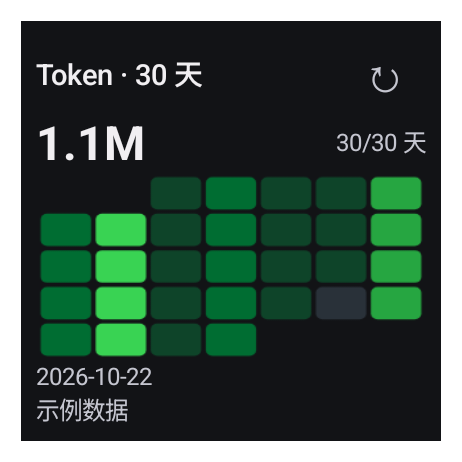

# 30 天 Token 热力图

「额度 → Token 使用趋势」支持 GitHub 贡献图风格的热力图和条形图。alpha30 起，近 7 天和近 30 天都可通过「条形图／热力图」按钮切换，切换保留当前时间范围、汇总和逐日明细，不发起网络请求。选择保存在本机，重启后沿用；尚未选择时保持原有的 7 天条形图、30 天热力图默认值。

alpha31 起，热力图横向固定为周一至周日，每行一周。App 将图表铺满卡片的可用宽度，并按实际周数调整高度；7 天不会再占用固定的 30 天图表高度。

- 7／30 个格子对应截至服务端最新记录日期的连续 7／30 天，跨月也不会丢失日期。
- 绿色深浅按本周期最高日用量分成四档，灰色表示明确记录的 0；带横线的空心格表示没有返回数据。窗口外的周首、周尾留白。
- 点击格子显示日期与用量；「逐日明细」提供完整日期列表，支持无障碍阅读。累计数仅汇总已返回的记录。
- 简体中文、English、日本語以及浅色／深色主题使用同一套数据规则。

## 桌面组件

在 App「小组件」页面点击「添加 Token 热力图组件」，或从系统桌面组件列表选择「Quodex → Token 热力图 · 30 天」。小米、Redmi、POCO 继续使用[桌面快捷方式权限提醒](HOME_SCREEN_PERMISSION.md)。

组件默认 2×2，可缩放，最小内容区域为 110×110 dp。alpha31 将图表改为占满内容宽度的七列日历，去掉组件里过小的坐标文字；最小尺寸下把合计并入标题行，宽布局的汇总也移到图表上方。单元格可随可用空间调整长宽，不再因为高度不足而整体缩成窄条。紧凑布局显示 30 天热力图、已返回日用量合计、服务端截止日期和缓存／示例状态；空间足够时还显示有记录的天数，宽布局保留本地获取时间。无障碍说明始终提供完整汇总和获取时间。外观可以独立选择跟随系统、浅色或深色；点右上角刷新按钮原地更新，点图表区域进入 App 并定位到 30 日热力图，不覆盖手动保存的图表偏好。已有桌面实例由 Launcher 保留尺寸，可缩小或重新添加。

首次添加组件自动获取 token 统计。只要保留该组件，现有后台同步任务会更新其数据，采用 token 接口独立的一小时缓存与服务端限流策略。手动刷新优先执行，超时或暂时失败则交由 WorkManager 有界重试；这一路径不额外刷新已有的额度快照。实际后台执行时机仍受 Android 网络、省电及厂商策略约束。

接口失败时保留上次数据并标为「旧数据」。无每日数据时显示说明，不按额度百分比推算；退出账号清除组件里的账号数据。App 内预览和演示模式使用明确标注的示例数据。

## 验证

日期映射测试覆盖闰日、跨月、七种起始星期、零值／缺失值、分级边界及大整数。Android 测试使用真实 AppWidgetHost、RemoteViews 和触摸事件，检查组件尺寸、深色模式、200% 系统字体、添加后取数、独立刷新、缓存错误状态，以及冷启动和已有页面下的 30 日跳转。

后台数据更新导致 30 天窗口变化后，恢复的选中日期若已超出窗口，则显示最新记录日期；状态恢复测试覆盖了这一场景。

2026-10-30 本地验证：182 项 JVM 测试通过，debug/release lint 与构建通过；API 37 模拟器的 Token、热力图组件、权限引导及界面回归共 16 项通过，另有 1 项宽屏测试因当前窗口尺寸跳过。英文、日文最小尺寸及中文 200% 字体组件均检查了真实布局和文字裁切。发布仍以 GitHub 六组 Android CI 的实际结果为准。

2026-10-31 alpha31 本地验证：204 项 JVM 测试、55 项发布脚本测试、debug lint 与 APK 构建通过；API 37 专项 12 项中 11 项通过，包括 App 全宽／自适应高度、日期点击、状态恢复、组件六种尺寸与主题、英文／日文最小尺寸和 200% 字体。随后补充英文／日文 160、220 dp 与宽组件 200% 字体检查，以及同一份示例数据的图表截图，两项专项复测均通过。渲染像素检查要求热力格占据 App 图表宽度的 80% 以上、实际组件宿主宽度的 68% 以上。首次添加后取数的 1 项因本机模拟器网络只有 PARTIAL_CONNECTIVITY、未通过系统验证而失败，保留原断言，完整取数与刷新回归结果见 [PR #45](https://github.com/tsonglew/Quodex/pull/45) 的 GitHub 六组设备测试。

以下截图来自 alpha31 debug / API 37 模拟器及真实 AppWidgetHost，使用同一份明确标注的示例数据。图片原样保存，不代表真实账号用量。

| App 30 日热力图 | App 30 日条形图 | 2×2 桌面组件 |
| --- | --- | --- |
|  |  |  |

